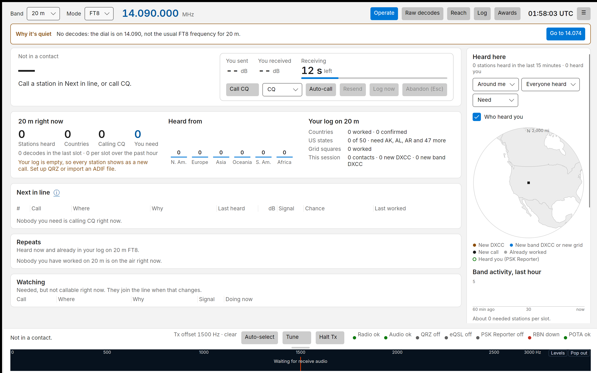
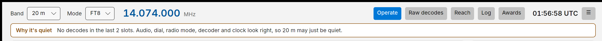
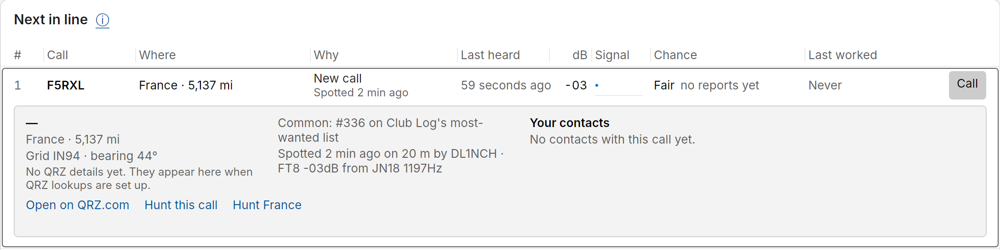
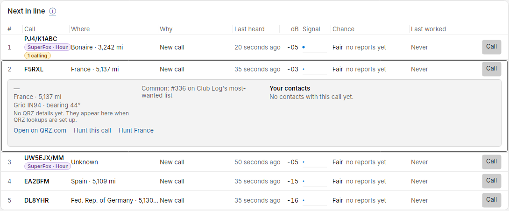
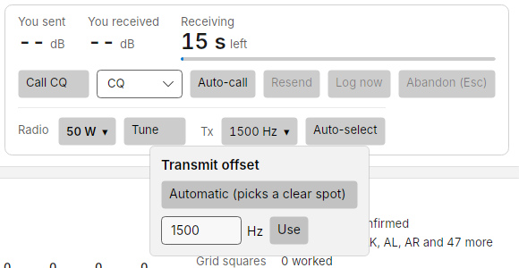

# The Operate screen

Operate is where you spend your time on the air. Everything you need during a session is on this one screen; you
should not need Settings while operating.

## Top bar

| Item | What it does |
| --- | --- |
| **Band** | The band you are on, filled in at start-up, and follows the radio when you change band on it ([below](#changing-band-on-the-radio)). Changes band: Costas sets the radio's dial frequency, clears the station list and loads your log totals for the new band. Locked while transmitting |
| **Mode** | FT8, FT4, PSK31, PSK63 or RTTY. Changes the slot length and dial frequency. Locked while transmitting. For PSK31, PSK63 and RTTY see [PSK31, PSK63 and RTTY](keyboard-modes.md) |
| Frequency | The dial frequency read from the radio, in MHz. Click it to type another frequency or use one you saved ([below](#typing-a-frequency)). Locked while transmitting |
| **Operate**, **Raw decodes**, **Reach**, **Log**, **Awards** | The five views. ++ctrl+1++ to ++ctrl+5++, or ++ctrl+tab++ for the next one |
| Callsign | Only when you have more than one [station profile](settings.md): the callsign and profile in use, such as **K1UTA · Ash**, so everyone at the desk can see whose callsign is on the air. It is also in the window title. It turns amber for a minute after someone [switched to their own profile from the phone](phone.md). Click it to switch profiles; that works only while the station is idle (not transmitting, no contact in progress, CQ and Auto-call off). **Edit profiles…** opens Settings |
| Clock | UTC, corrected from internet time when your PC clock is off (the tooltip says by how much). Turns amber with a tooltip when the clock is still off by more than 0.5 s, red above 2 s |
| **☰** | Mini mode, Settings, Station setup, Diagnostics, Keyboard shortcuts, About |

### Typing a frequency

DXpeditions often sit off the standard frequency (14.090 instead of 14.074, for example). Click the dial frequency,
type the new one (`14.090`, `14090` in kHz, or `14.090.000` all work) and press **Tune** or ++enter++. Costas moves the
radio there, and to that band if it is a different one. The usual transmit limits still apply: Costas will not tune
outside the amateur bands, or to a band it has no transmit limits for.

### Changing band on the radio

You can also change band with the radio's own band button or dial. Costas reads the radio's frequency every second and,
when it lands on another band, follows it: the **Band** menu switches to the new band, Next in line and Repeats are
cleared at once (even with the pointer over them), your
per-band transmit level is used, and the new band is remembered for next time. Decodes from the slot that was running
when the band changed are dropped, so a station from the old band can't come back or be answered on the new one. Costas
does not move the radio back.
Any contact or CQ in progress ends, and a transmission waiting for the next slot is cancelled. Tuning off the standard
FT8/FT4 frequency within the same band only changes the frequency shown.

If the radio goes outside the amateur bands (a broadcast station, say), Costas keeps the last band in the menu, says
*The radio is on 15.000 MHz, outside the amateur bands* in the status line, and will not transmit until you tune back.

**Save the current frequency** adds the frequency the radio is on to *Your frequencies* in the same menu, so the next
time it is one click. **Remove** takes one off the list. The standard frequencies are not saved there; they are what the
**Band** menu picks.

### Which bands are open

Open the **Band** menu or see **Band activity near you** in [Reach](maps.md#reach-view) for spots, continents and countries you need on each band. The **Band** menu also selects the operating band. It also names stations on your [Hunt list](hunt.md) heard on each band in the last 15 minutes (*Hunting: VK9XA*).

Two banners can appear under the top bar:

- **ON AIR** (red) while Costas is transmitting, with the message being sent and a **Halt (Esc)** button. Next to
  Halt are the radio's own meters, read over CAT twice a second: **PO** (the watts the radio's PO meter reads, which
  can differ from the power setting in the bottom bar), an **ALC** bar with *OK* or *High*, and **SWR**. A high reading
  turns yellow (SWR 2 or more, ALC high); hover for advice. A meter your radio does not report is left out, and power
  out needs Hamlib 4.6 or newer. With an instrument skin the faceplate shows the meters instead. Display only: the
  meters never stop or change a transmission.
- **Radio not connected** (amber) when the radio is not set up or not answering, with a **Station setup** button.

A **Hunt list** bar appears below them when a station on your [Hunt list](hunt.md) is heard, with **Go to** *band*
and **Dismiss**.

## Why it's quiet

When FT8 or FT4 has decoded nothing for two slots in a row (30 seconds in FT8, 15 in FT4), a line appears under the
top bar with the most likely reason and, where there is one, the fix. Two slots, so that both the even and the odd
slot have passed with nothing heard. Slots you transmitted in don't count, and changing band, mode or frequency starts
the count again. The line goes as soon as anything is decoded.

Costas checks, in this order: the receive audio (no audio, silence, too quiet or clipping, measured the same way as
the input meter in Station setup), the dial (more than 1 kHz from the band's usual FT8 or FT4 frequency), the
radio's mode (anything other than USB data or USB), the decoder, and your clock (off by more than the clock limit,
2 s unless you changed it). The first one that is wrong is shown. If everything looks right it says so: the band may
just be quiet.

When the fix is a frequency, the line has a **Go to 14.074** button (with the band's real frequency). Click it and
Costas tunes the radio there in USB data, exactly as if you had typed the frequency in the
[frequency menu](#typing-a-frequency). Nothing happens to your radio until you click: the line only gives advice. The
button is hidden while you are transmitting.

The line is not shown when no radio is set up (Costas is not receiving anything then), and when the radio is not
connected the yellow *Radio not connected* banner explains instead. It is shown on the Operate view only, and on the
[phone page](phone.md). PSK and RTTY have no slots, so they don't show it.

## Big and small windows

Costas picks one of two layouts for the Operate view from the size of its window, and switches as you resize it:

- **Big window** (1280 pixels wide and 900 tall or more, such as a maximised window on a 1080p or larger monitor):
  the full idle card with the band summary card under it, and the side column's cards stacked one above the other.
- **Small window** (narrower or shorter than that, such as a 13-inch laptop): a compact layout that gives the call
  list the room. The idle card folds to two short lines with a band strip, the side column becomes one card with tabs
  that you can fold to a thin rail, and the update bar is one slim line.

Sizes are in Windows' scaled pixels, so a 1920 × 1080 laptop screen at 125% scaling counts as 1536 × 864 and gets the
compact layout.

To keep one layout whatever the window size, pick **Roomy** or **Compact** in
[Settings › Appearance › Operate layout](settings.md#appearance). **Automatic** (the default) switches as above.

## The top slot: idle card and band summary

On a big window, the idle card has the same shape as the contact panel: **Not in a contact**, the empty reports, the
slot countdown, **Call CQ**, the CQ picker, **Auto-call**, and **Resend**, **Log now** and **Abandon** (greyed out
until a contact starts). Under it is the **band summary**, the same numbers as the side column's **Band** tab
described [below](#side-column), laid out across the width. If the window is too short for both, the band summary
moves to the top of the call list and scrolls with it, so the card is never cut off.

### Band advice

When the evidence supports it, a line under the band summary (on a small window, on the **Band** tab) says which band
looks best for you right now, for example:

- *15 m is open to Europe from your area: 23 stations there heard 6 stations near you in the last 15 min.* Stations
  within 300 miles of you are being heard in Europe on 15 m, and the band you are on is not reaching Europe.
- *20 m is open to Europe for you: 12 stations there heard you in the last 15 min.* Your own signal on this band, from
  PSK Reporter and the Reverse Beacon Network.
- *20 m is closing to Europe: 1 station there heard stations near you in the last 15 min, 14 in the 15 min before.*

If countries you still need on that band are among the listeners, the line says so. Hover over it to see the
numbers per continent, how recent the newest report is, and the rule that was met. A band is called open only when at
least 5 stations on another continent heard at least 2 stations near you (or 5 heard you). Your own continent is never
named. When Costas isn't sure, it says nothing. It needs the same settings as the band menu's activity (see
[Maps](maps.md#band-activity-near-you)), and it shows nothing with no live reports. The line is advice only: Costas never
changes band for you.

### Small window: idle card and band strip

On a small window, the card at the top folds to two short lines when you are not in a contact, so the call list gets
the room.

The first line says **Not in a contact** (or *Calling CQ*, or *Auto-call on*) with the slot countdown, **Call CQ**,
the CQ picker and **Auto-call**. **Resend**, **Log now** and **Abandon** come back with the full card when a contact
starts.

The second line is the **band strip**: **20 m now** (named after the current band), stations heard in the last 5
minutes, countries, how many are calling CQ, and **You need** (stations that are new to you in some way). Next to the
counts is a small bar per continent (NA, EU, AS, OC, SA, AF; hover for the count) and one line for your log on this
band, such as *19 countries · 46/50 states · 142 grids*. Hover over it for the states you still need.

**More ▾** opens the **Band** tab in the [side column](#side-column) with the full summary. While that tab is
showing, the strip is hidden, so the same numbers are never on screen twice.

When you call or answer a station, this card becomes the contact panel. See [Making contacts](contacts.md).

The card stays put at the top. Only the call list below it (Next in line, Repeats and Watching) scrolls, so the
countdown, Call CQ and the contact's progress are always in view.

## Next in line

The stations you need that you can call right now, best first. At most 12 rows; the rest are counted underneath.

In FT8 the list fills in about 13 seconds into each slot, from Costas's early decode pass, so you can pick a station
before the slot ends. When the full decode lands a couple of seconds later, the rows already shown keep their order:
stations found only by the full decode go in at their rank, and stations that can no longer be called drop out.

A station calling CQ stays listed for 2 minutes after it was last heard (change this in
[Settings › Who to call](settings.md#who-to-call)), so one missed decode does not drop it. *Doing now* then says
*Calling CQ, missed last slot*, and it sorts below stations heard in their latest slot. It leaves the list as soon as
it is heard working someone else, and moves to Watching once the time is up.

| Column | Meaning |
| --- | --- |
| **#** | Rank |
| **Call** | Callsign. A small amber tag under it, such as *3 calling*, means you can hear other stations calling them right now, so you know it is a pileup before you click **Call**. Hover the tag to see who, with their signal at your station |
| **Where** | Country (or state for the USA, province for Canada) and distance |
| **Why** | Why you need them: **New DXCC** (a DXCC entity not in your log), **New DXCC 20 m** (in your log, but not on this band; hover to see which bands you already have it on), **New grid** with the grid, such as **New grid DO62**, or **New call**. A new DXCC also gets a small rarity meter, five cells from common to very rare, from Club Log's most-wanted list. Hover for its rank. A station activating a park for Parks on the Air gets a second line: **New park US-1234** when that park is not in your log yet, *Park US-1234* when it is, or *POTA* when it is calling CQ POTA but nobody has spotted it on this band yet. Hover for the park's name. A station at a new park moves up: it comes right after your first need (new DXCC, unless you changed the order), and it is listed even if you have already worked that call on this band, because a new park is a new contact for park hunters. You can turn this off in Settings › Who to call. With [DX cluster spots](settings.md#who-to-call) on, a station spotted on this band in the last 30 minutes shows *Spotted 4 min ago*; hover to see the band, the spotter and the comment. It does not change the order |
| **Doing now** | *Calling CQ, 3 slots*, *Calling CQ DX*, *Calling you*, and *fading* when their signal is dropping |
| **Last heard** | How long ago their last decoded transmission ended, counting up every second |
| **dB** | Their signal at your station |
| **Signal** | A sparkline of their last 6 slots, gaps where they were not decoded. Hover for the values |
| **Chance** | **Good**, Fair or Long shot, with what it is based on beside it: *hears you at -22* (they reported you on PSK Reporter), *heard in Japan at -17* (someone in their country or area did), or *no reports yet*. With no reports, a station at -18 dB or better is Fair and a weaker one is a Long shot |
| **Last worked** | Your most recent contact with that call on any band or mode (*2026-10-03 · 40 m*), or *Never*. Hover for the details |
| button | **Call**, or **Answer** when they are calling you |

### Auto-call

**Auto-call**, beside **Call CQ** on the contact card, works down Next in line for you. Click it and Costas calls the
top station in your next slot. When that contact ends, logged or not, it calls the next station at the top of the list,
and so on. The button fills in the accent colour and reads **Stop auto-call** while it runs, and between contacts the card says *Auto-call on*. Click the button
again to stop.

- Each station is called once per run. One that did not answer (after the usual retries) is not called again until
  you stop and start Auto-call.
- Only stations heard in their latest slot are called. A CQ caller that missed a slot waits until it is heard again.
- Stations you have worked drop out of the list as usual, so they are not called again.
- If someone you marked **Call when free** comes free, that station goes first.
- A DXpedition Fox is worked the Hound way, just as when you click **Call**.

Auto-call stops when you press **Esc** (even the first Esc, which keeps the contact so a late `RR73` still logs),
**Halt Tx**, **Abandon** or **Call CQ**, when you change band or mode (also on the radio), and when Costas refuses or
fails to transmit, for example with the dial outside the band. It also stops after the Tx watchdog time (6 minutes,
**Settings › Transmitting › Watchdog**) with no click or key from you, so it never keeps calling after you have walked away. Auto-call
is FT8 and FT4 only, and it is always off when Costas starts.

You still need to be at the radio: Auto-call saves clicks, it does not make the station unattended. The watchdog is
there for that reason.

### Resizing columns

Drag the edge between two column headings to move it; a faint line marks each edge and turns blue under the pointer.
Only the two columns beside the edge change: one grows by what the other gives up, so the rest of the table stays put
and a column can grow even when the window is narrow. Beside *Doing now*, *Doing now* gives or takes the room. Next in
line and Repeats share their columns, so resizing one resizes the other and they stay lined up. Watching has its own
headings and widths and works the same way. Double-click an edge to put both columns beside it back to their usual
widths. Costas remembers your widths the next time it starts.

A column can't grow past the point where *Doing now* would disappear.

On a small window, such as a 13-inch laptop, the **Call** buttons always stay on screen. To make room, the table first
narrows **Chance** and **Where** (long text ends in "…"; hover for the full reason), then hides *Doing now*,
**Last worked**, **Signal** and the **#** rank, in that order. **Last heard** is the last to go. Widen the window and
they come back at the widths you set.

How the order works: stations are grouped by need (new DXCC first), then by chance, then by how well they hear
you, then by their signal. The **ⓘ** beside the title shows the current rules in one sentence; click it to change
them (the same options as [Settings › Who to call](settings.md#who-to-call)).

The list never reshuffles under your mouse. If it needs to re-rank while you are pointing at it, a **List updated**
pill appears; it applies when you click it or move the pointer away.

The station you are in a contact with is tinted, with a bar down its left edge, the same in Repeats. That tint
only ever marks the station you are working.

Selecting a row (click, or ++up++ / ++down++) outlines it. To see the station's details, click its **call** in the
row or press ++i++: a details strip opens under the row (in Repeats too). It shows the station's name (from QRZ lookups),
location, grid, bearing and your past contacts with that call. While the strip is open it follows the row you select;
close it by clicking the row again, with **✕**, ++esc++ or ++i++. A double-click calls the station and never opens the strip. For a station at a park it adds the park, such as
*New park US-1234 · Example Lake State Park, US-WI*, and for a station spotted on the DX cluster its newest spot, such
as *Spotted 2 min ago on 20 m by DL1NCH · FT8 -03dB from JN18 1197Hz*:

### Who else is calling

The *3 calling* tag on a row is the short version. When other stations are calling the one you selected, the details strip adds a **Who else is calling** section, shaded yellow so it stands out (the same box shows under your contact when you call a busy station, and on the phone's station sheet):

- how many stations called it in its latest answer slot, with each caller's signal at your station and audio offset;
- whether your transmit offset is clear of them, or which caller is sitting on top of it;
- once it has answered a few callers, how it chooses: *Answered the strongest caller you heard in 4 of its last 5 contacts.*

It is built from your own decodes, so it only knows the callers you can hear, and a caller that is strong for you may be
weak for them. The same section shows in the **About** card while you are calling that station.

To call a station: click its **Call** button, double-click the row, or select it and press ++enter++.

!!! note "Chance without PSK Reporter"
    If PSK Reporter is off or unreachable, chance is worked out from their signal alone: Good at -10 dB or better,
    Fair at -18 or better, otherwise Long shot.

## Repeats

Directly under Next in line: stations you can hear now that are already in your log on this band and mode. Next in
line leaves them out because you do not need them, but you may still want to work them again: a friend, a regular,
or someone you owe a better report. At most 8 rows; the rest are counted underneath.

It has the same columns as Next in line, lined up under them (including the amber *calling* tag under a busy station's call), with two differences:

- **Why** says whether your contact with them on this band and mode is confirmed: ***Not confirmed*** or *Confirmed*.
  Stations not confirmed are listed first, as working them again is the usual reason to call.
- **Doing now** says why they cannot be called right now instead, in grey: *In a contact with EA5HVK*, *Went quiet
  2 minutes ago* (counting up, like Last heard). The **Call** button still works, so you can call a station that went quiet or is finishing a
  contact. A station *in a contact* with someone else is not called: the contact card says *In another contact* and
  why (see [Making contacts](contacts.md)), unless you turned on **Keep calling a station that is working someone
  else** in Settings › Contacts.

**Last worked** shows when and on which band you last worked them: *Today · 20 m*, *Yesterday · 40 m*,
*2026-10-03 · 20 m*. Hover for the number of contacts, the exact time, the mode and whether it is confirmed.

Stations you can call now come first, then the same order as Next in line. Like Next in line, the list holds still
while your pointer is over it and catches up when you move away. When nobody you have worked on this band is on the
air, it says so.

## Watching

Stations you need that you cannot call yet: they went quiet, or are in a contact with someone else
(*In a contact with EA5HVK*, *Finishing a contact with K7RGB*). They move into Next in line when that changes.
A DXpedition running Fox/Hound is never here: it is always working someone, so it stays in Next in line with a
purple **Fox · Hound** tag, as *DXpedition (Fox/Hound), working Hounds*. See [Working a DXpedition](contacts.md#working-a-dxpedition-foxhound).

A station calling CQ in a contest (`CQ RU`, `CQ FD`, `CQ WW`, `CQ TEST` and the like) is listed here as *Contest
(CQ RU): pick it beside Call CQ to work it*. It expects a contest exchange, so it can only be called once you
[pick that contest](contests.md). While the contest is picked, its stations move into Next in line.

When everyone in Watching is only a new call or a new grid, the list folds to one line, such as *12 needed stations
busy: 11 new calls, 1 new grid*. **Show all** opens it and **Fold** closes it again; Costas remembers your choice until
you change it. A new DXCC or a new band DXCC is never folded away: as soon as one is in Watching, its rows show.

Stations you have already worked on this band are not in Watching; they are in [Repeats](#repeats).

### Call when free

Each Watching row has a **Call when free** button. Click it on a station you want, and Costas calls that station
for you as soon as its current contact is over. The row then reads *· calling when free* and the button changes to
**Cancel**.

Costas calls the station in your next slot after it is heard signing off with someone else (`RR73`, `RRR` or
`73`), or calling CQ again, the same moment you would tail-end it by hand. There is no extra wait.

Nothing goes out unless you clicked the link, and the usual transmit checks still apply. The mark is dropped when:

- the call starts (it is used once; the contact then runs as if you had clicked **Call**),
- you click **Cancel**, press **Halt Tx**, or change band or mode,
- the station is no longer heard, or
- the Tx watchdog time passes with no click or key from you, so nothing starts after you have walked away.

If you are in a contact of your own when the station comes free, your contact carries on and the station is called
once yours ends, if it is still free then. You can mark more than one station; the first one marked that comes
free is called first. A marked station is never folded away, even past the first eight rows.

## Side column

On a big window the column at the right shows two cards, one above the other, and scrolls: **Heard here** with
**Band activity** and **Your signal** under it, then **Worked this session**. The band summary is on the left, under
the idle card.

On a small window it is one card with four tabs, one showing at a time. Costas remembers the tab you left it on.

- **Band**: the full band summary. **20 m right now** has stations heard in the last 5 minutes, countries, how many
  are calling CQ and **You need**, with decodes in the last slot and the average per slot over the past hour, and the
  [band advice](#band-advice) line when there is one.
  **Heard from** is a bar per continent (N. Am., Europe, Asia, Oceania, S. Am., Africa). **Your log on 20 m** has
  countries worked and confirmed on this band, US states worked (and the first few you still need), grid squares
  worked, and **This session**: contacts, new DXCC and new band DXCC this session. A session starts when you open
  Costas, or after 2 hours with no contact. This tab stays available during a contact.
- **Heard**: **Heard here**, a map of the stations you have decoded in the last 15 minutes (see
  [Maps and who hears you](maps.md#heard-here)), and **Band activity, last hour**: a bar per minute of decodes per
  slot (grey) and needed stations per slot (blue), with a sentence saying whether the band is busier or quieter than
  half an hour ago.
- **Signal**: **Your signal on 20 m**: how many stations hear you, which countries they are in (*USA 12 · Canada 3 · Japan 1*, most stations first; after six countries it says *+4 more*, and hovering over the line lists every country with its best report and farthest station), the farthest and the best report, plus a graph of distinct receivers in five-minute intervals over the last hour. Each receiver counts once per interval. Times are local and the faded final bar is still incomplete. History stays available when you switch back to a band or mode during this session; recent stored reports refill it at start-up, and changing your station clears the in-memory counts. Reports may arrive late, and transmitting less or losing the feed can lower counts even when the band has not changed.
  **Open reach view** goes to the full view.
- **Session**: **Worked this session**, your latest contacts this session with their QRZ upload state. **Show all in
  the log** opens the Log view.

{ width="320" }

### Folding the side column

On a small window, press **»** at the top right of the column to fold it to a thin rail. The call list then takes the full width of the
window, so on a laptop the columns that were trimmed or hidden to keep the **Call** buttons on screen come back. The
rail still says what matters, such as *20 m · 198 you need* and *Your signal · 146 heard you*. Click either to open
the column on that tab, or **«** to open it where you left it. Costas remembers whether the column is folded. On a
big window there is no fold; the column comes back folded the next time the window is small.

{ width="400" }

## Bottom bar

| Item | What it does |
| --- | --- |
| Status text | One line: *Not in a contact. Enter calls NT2A, the top of the line.*, *Transmitting to F5RXL.*, *Waiting for F5RXL.*, or a fault in red |
| **Tx offset 1650 Hz · clear** | Your transmit audio offset. Click to choose **Automatic (picks a clear spot)**, the default, or type a fixed value (200 to 2900 Hz) and press **Use** |
| **Call CQ** | Starts calling CQ in the next slot. Becomes **Stop CQ** while running. ++ctrl+q++ |
| **50 W** | The radio's power setting, shown when the radio reports it over CAT. Click to type a new power and press **Use** (or ++enter++), or step it with **−5** and **+5**. Anything outside 1 W to the radio's maximum is refused; a radio with its own minimum (5 W on the FT-710) keeps it and Costas says so. Changes the setting only, never keys the radio, and not while a transmission is on the air. On the FT-710 it needs Hamlib 4.6 or newer, which the Windows installer includes. If the range is wrong for your radio (for example 1 to 200 W on a 100 W radio, so asking for 100 W gives 50 W), type the radio's top power in **Settings › Station › Radio's top power** |
| **Tune** | Starts your radio's own antenna tuner, as its TUNE button would. If the radio has no tuner Costas can start (or its tuner is switched off), Costas sends a steady tone at your transmit offset for up to 10 seconds instead, for an external tuner. Becomes **Stop tune** for up to 10 seconds; click it to stop. Available only when nothing else is being sent; calling a station or CQ stops the tone |
| **Halt Tx** | Always available. Drops PTT at once and stops sequencing. ++esc++ does the same |
| Slot progress | *Receiving* or *Transmitting*, seconds to the next slot, and a bar. Shown away from Operate, where the contact card has it. Hidden with an instrument skin, whose faceplate shows it |
| Meter warning | Appears after a transmission whose SWR or ALC was high, for example *SWR 3.4 · ALC 70%*. Hover for advice. The live meters are in the red **ON AIR** bar at the top |
| Indicators | **Radio**, **Audio**, **QRZ**, **eQSL**, **PSK Reporter**, **RBN**, **POTA**: a dot and a word each. Click to open Diagnostics |

The strip along the bottom is a waterfall of the passband with a red line at your transmit offset: click anywhere
between 200 and 2900 Hz to move your offset there. **Auto-select** goes back to Automatic, which picks a clear spot in the passband for you each time.

### A bigger waterfall

The waterfall starts as a thin strip showing the last few seconds. To make it bigger:

- **Drag the grip** (the short bar on the strip's top edge) upwards. The waterfall can grow to half the window; the
  panels above it get shorter and scroll. Double-click the grip to go back to the thin strip. With the grip focused,
  the up and down arrow keys resize it and ++home++ makes it thin again.
- **Pop it out**: click **Pop out** at the right end of the strip to open the waterfall in its own window. Size it however you
  like or drag it to a second monitor. While it is open the strip leaves the main window, so the waterfall is never
  shown twice. Click **Pop in**, or close the window, to put it back.

A taller waterfall shows more time rather than stretching the same few seconds: about 12 seconds per 100 pixels, up to
80 seconds. Once it is taller than the strip, faint lines mark where each receive slot began. Clicking it picks your
transmit offset at any size, and ++esc++ in the waterfall window halts transmit as it does in the main window. Costas
remembers the strip's height, and whether the waterfall was popped out and where.

## Other views on a second monitor

**Raw decodes**, **Reach**, **Log** and **Awards** can each have their own window too, so you can keep the map or
your log on a second monitor while you operate. Pick the view's tab, then click **Pop out** next to the tabs. The
view moves to a new window that you can size and place anywhere; its tab in the main window then says where it went.
Click that tab again to bring the window to the front, and click **Pop in** (in either window) or close the window to
put the view back.

A popped-out view keeps updating as you operate: the Reach map follows new reports, and Log and Awards refresh when
a contact is logged. ++esc++ in any of these windows halts transmit as it does in the main window. Costas remembers
which views were out and where, and opens them there again next time. Operate always stays in the main window.

## Mini mode

Want to browse, log or check email while you keep an eye on the band? Choose **Mini mode** from the **☰** menu, or press ++ctrl+m++. Costas shrinks to a small strip that stays on top of your other windows.

{ width="480" }

The top row shows the band, the slot countdown and how many stations are in line. When someone calls you it says so in amber instead, for example *1 calling you*. The second row shows the station at the top of Next in line and why it's worth calling. **Call** calls it, exactly as calling it from the full window would.

During a contact the strip shows who you're working, a dot for each step of the contact, and the message on the air or the one you're waiting for. The strip is outlined in red while you transmit.

{ width="480" }

In PSK and RTTY the dots give way to a row of macro keys, and F1 to F12 send them from the strip.

When a station on your [Hunt list](hunt.md) is heard, the strip adds a line saying where, with ✕ to dismiss it.

**Halt** is always there, and ++esc++ works in the strip too. Nothing is sent without a click.

To get the full window back, click **⤢** or close the strip. Costas remembers where you put it.
