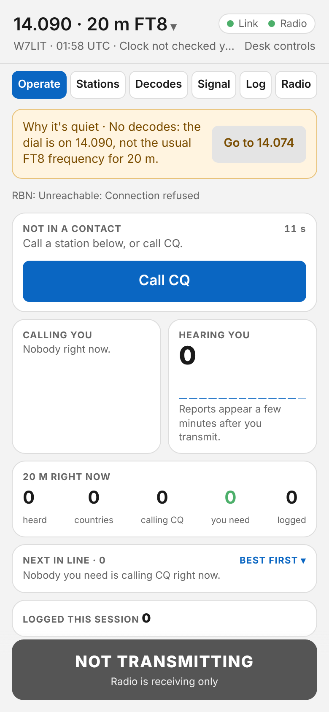

# Remote Operation (phone/tablet support on local network)

Costas can serve a page to a phone on your home network, so you can work stations from the couch while the radio
stays on the station computer. The phone opens the page in its browser; there is nothing to install. It is off until
you turn it on.

{ width="320" }

## Turning it on and connecting a phone

1. On the station computer, open **Settings › Mobile connection** and tick **Let a phone on this network operate the
   station**. It starts at once; there is no need to save first.
2. If Windows asks whether Costas may use the network, choose **Allow** for private networks. Phones cannot connect
   until you do.
3. Settings shows the address to open on the phone, for example `http://192.168.1.20:8073/`.
4. On the phone, open the address. There is no code to type: the page connects straight away.

Any phone or tablet on your home network can open the page and operate the station, so turn it off when you are not
using it if others share your Wi-Fi.

### If the phone cannot connect

Press **Check why a phone can't connect** in **Settings › Mobile connection**. Costas checks, from the station
computer, that the page is served and answers on the address shown, whether Windows treats the network as *Public*,
and which Windows Firewall rules apply to Costas. Each finding starts with ✓ or ✗ and says what to change. It changes
nothing itself. The usual causes:

- **The network is Public.** Choosing Allow for private networks does not cover a network Windows calls Public. If it
  is your home network, make it Private: Windows **Settings › Network & internet ›** your Wi-Fi or Ethernet **›
  Properties › Private network**.
- **A Block rule.** Closing or cancelling the Windows question leaves a rule that blocks Costas. Open **Windows
  Security › Firewall & network protection › Allow an app through firewall › Change settings**, find Costas and tick
  **Private**.
- **Another firewall** (Norton, McAfee, Bitdefender and the like) needs Costas allowed too.
- **On the phone:** use the same Wi-Fi as the computer (a guest network usually keeps devices apart), turn off any VPN,
  and type the address exactly as shown, starting `http://`, not `https://`.

## Adding it to your home screen

The page can sit on your home screen with the Costas icon, like an app.

- **iPhone or iPad:** in Safari, tap **Share**, then **Add to Home Screen**. It opens full screen, without Safari's
  address bar.
- **Android:** in Chrome, open the menu and tap **Add to Home screen**. The icon opens the page in Chrome. Chrome only
  installs full-screen apps from secure (HTTPS) addresses, and Costas serves the page over plain HTTP on your home
  network.

If the station computer's address changes (for example, your router hands it a new one), add the page again from the
new address.

If you use Tailscale, one icon can work at home and away: see
[One icon for home and away](#one-icon-for-home-and-away).

## Operating away from home

The same page works from anywhere (on mobile data, at work, on holiday) through
[Tailscale](https://tailscale.com), a free app that links your own devices over an encrypted private connection.
Nothing is opened on your router, and only devices signed in to your Tailscale account can reach the station.

1. On the station computer, install Tailscale from [tailscale.com/download](https://tailscale.com/download) and sign
   in (a Google, Microsoft or Apple account works).
2. On the phone, install the **Tailscale** app (App Store or Google Play) and sign in with the same account. On iPhone,
   allow it to add a VPN configuration. Turning on **VPN On Demand** in the app keeps it connected.
3. Open **Settings › Mobile connection** on the station computer. Under **Away from home** it shows the Tailscale
   address to open, for example `http://100.101.102.103:8073/`.
4. Before you leave, check that the station computer will not sleep (Windows **Settings › System › Power** › **Sleep:
   Never**), that Costas is running and that the mobile connection is on. If Windows restarts for an update, Costas
   has to be started again before the page comes back.

### One icon for home and away

A home-screen icon always opens the one address it was added from. Normally the home address (such as
`http://192.168.1.20:8073/`) only works on your Wi-Fi and the Tailscale address only works while Tailscale is on. One
setting in Tailscale makes the home address work away from home as well, so the icon you already added at home works
everywhere, and at home it works with Tailscale off:

1. Give the station computer a fixed address on your router (often called a **DHCP reservation**), so the home address
   does not change.
2. Open **Settings › Mobile connection** in Costas. Under **Away from home** it shows a command such as
   `tailscale set --advertise-routes=192.168.1.20/32`. Open a Command Prompt on the station computer and run it.
3. Sign in to the [Tailscale admin console](https://login.tailscale.com/admin/machines), open the station computer,
   choose **Edit route settings** and turn on the route.

Away from home, with Tailscale on in the phone, the home address now reaches the station computer through Tailscale.
At home it goes straight over your Wi-Fi whether Tailscale is on or off. The route covers only the station computer,
not the rest of your home network.

If you skip this, add the **Tailscale** address to your home screen instead: it works at home too, as long as
Tailscale is on in the phone.

The phone page and all its safety rules work exactly as they do at home: transmit stops 15 seconds after the phone
loses touch, and the watchdog is at most 3 minutes. You do not hear the radio's audio, which FT8 and FT4 do not need.

Do not forward port 8073 on your router instead. Costas refuses addresses from the open internet on purpose: unless
you turn on sign-in (below), the page has no password, so anyone who found it could transmit.

## Requiring a username and password

You do not need this at home or with Tailscale: leave it off and phones connect as described above. It is for putting
Costas behind a reverse proxy such as nginx with your own https address, or for a station several people share.

Turn it on in **Settings › Mobile connection** under **Sign-in**:

1. Press **Add a user**, type a username and a password (10 characters or more, one you use nowhere else), and leave
   **Allowed to sign in** ticked. Add one user for each person.
2. Tick **Require a username and password**. Costas will not save it until at least one allowed user has a password.
3. Press **Save**. It takes effect then: every phone already connected is signed out and has to sign in.

The phone page then shows a sign-in form. A sign-in lasts 30 days from the last time that phone used it, and **Sign
out** at the top of the page ends it. After five wrong passwords Costas makes you wait, starting at 30 seconds and
growing to 15 minutes.

Turning it off again also takes effect when you save: every signed-in phone is disconnected. One on your home network
or Tailscale reconnects at once with no password, as an unnamed phone that operates as the active profile. One that
comes through a reverse proxy is refused, because Costas never lets a proxy in without sign-in. Your users, their
passwords and their profile links are kept for when you turn it back on, and every phone then signs in again.

!!! warning "A password is only accepted where it travels encrypted"
    The page itself is plain HTTP, so Costas takes a password only through Tailscale or through your proxy over
    https. **A phone on plain home Wi-Fi cannot sign in**: open the Tailscale address instead (it works at home too,
    as long as Tailscale is on in the phone). A phone that has signed in once keeps working on home Wi-Fi with
    Tailscale off.

Managing users, in the list under **Sign-in**:

- **Edit** opens a user to change the name or password. Changing a password signs that user out on every device.
- Untick **Allowed to sign in** to keep a user but let none of their devices in.
- **Sign out everywhere** ends all of that user's sign-ins; they can sign in again.
- **Delete** takes the user off the list.
- **Operates as** links the user to a station profile, so another licensed operator works under their own callsign,
  log, contest exchanges and logbook accounts (QRZ, LoTW, eQSL, Club Log, Wavelog). Make the profile first with
  **New operator** on the Station page. Leave it on **The profile in use** and the user operates as whichever
  profile is active.

**Operates as** needs sign-in: with **Require a username and password** off, Costas cannot tell who is holding a
phone, so the links are kept but do nothing, and every phone operates as whichever profile is active at the desk.

Switching to your own profile is always a deliberate tap; nothing else switches it, so someone can sign in just to
watch. While another profile is in use, a linked user's page says *You're operating as K1UTA (Ash profile).* with an
**Operate as K1GLV** button. Tapping it switches Costas to your profile and takes control, but only when the station
is idle: while it is transmitting, in a contact, or has CQ or Auto-call on, the button is greyed out with the reason
(*The station is busy while calling CQ as K1UTA*), so the contact in progress is left alone. Everyone else sees
*Ash switched the station to K1GLV (Home profile).*

Until you have switched, anything that would go out or be logged under the profile in use (Call CQ, calling or
answering a station, Resend, Log now, the PSK and RTTY macros) is refused with *Tap Operate as K1GLV first*, so
nobody transmits under someone else's callsign. **Stop**, **Stop CQ**, **Abandon**, Tune, and the band, offset,
power and radio settings work as for anyone. A click at the desk takes control back but keeps your profile; the
callsign at the top of the desk window shows whose it is, and the desk operator switches back from there.

Changes take effect when you press **Save**. Passwords are never stored: Costas keeps only a scrambled check value
(a PBKDF2 hash) in the Windows credential store, so a forgotten password cannot be shown, only replaced.

### Behind a reverse proxy

While sign-in is off, Costas refuses every request that comes through a proxy, so a proxy can never put the station on
the internet without a password. Set the proxy to use https and to send the `X-Forwarded-For`, `X-Forwarded-Proto` and
`X-Forwarded-Host` headers; Costas refuses passwords sent through a proxy over plain http. If the proxy runs on another
computer, enter that computer's address in **Proxy address**; leave it empty when the proxy runs on the station
computer. A minimal nginx site:

```nginx
server {
    listen 443 ssl;
    server_name radio.example.org;
    # ssl_certificate ...; ssl_certificate_key ...;

    location / {
        proxy_pass http://127.0.0.1:8073;
        proxy_http_version 1.1;
        proxy_set_header Upgrade $http_upgrade;
        proxy_set_header Connection "upgrade";
        proxy_set_header Host $host;
        proxy_set_header X-Forwarded-For $proxy_add_x_forwarded_for;
        proxy_set_header X-Forwarded-Proto $scheme;
        proxy_set_header X-Forwarded-Host $host;
        proxy_read_timeout 60s;
    }
}
```

If **Settings › Mobile connection** warns that a request came from this computer itself while sign-in is off, and you
run a proxy on the station computer, turn on sign-in: the proxy may not be sending its headers, which would let anyone
who reaches it in with no password. If you only opened the page in a browser on the station computer, you can ignore
the warning.

## What the phone can do

The top of the page shows the band and frequency (tap it to change band or offset), the link to the station and
the radio, the clock and the decoder, and who is in control. Below it, five tabs cover what the desk's Operate view
shows, and a sixth, **Radio**, holds the radio's own controls. **HALT TX** is always on screen: at the bottom in portrait, at the right of the top bar in landscape.

The phone's **Operate** tab is a set of tiles built for a small screen rather than a copy of the desk:

- **Contact**, across the top: the station, where it is and why you need it, the message going out (or the one you are
  waiting for), the reports, a five-part progress bar labelled CQ, Grid, Report, R-rpt and RR73, the seconds left in
  the slot, and **Resend**, **Log now** and **Abandon**. The tile turns red while you transmit. Tap an underlined step to
  send it next. With no contact it shows **Call CQ** or **Stop CQ**.
- **Calling you**: who is answering you, with **Answer** or **Answer next**, and **✕** to leave a caller unanswered
  (as on the desk: nothing is sent, and it comes back only if it calls again after 2 minutes quiet). It turns amber
  when someone is calling.
- **Hearing you**: how many stations heard you in the last 15 minutes, a small chart of the last hour, and the farthest.
  Tap it for the Signal tab.
- **Band now**: stations heard, countries, calling CQ, you need, and contacts logged this session. Tap it for the Stations tab.
- **Next in line**: a compact table with each station's signal, why you need it, how many others are calling it, and
  **Call**. Tap **Best first** to sort by signal or by call instead; the phone remembers your choice.
- **Logged this session**: the count and the last few calls. Tap it for the Log tab.

On the other tabs the slot countdown bar sits under the top bar instead (red while you transmit).

{ width="320" }

| Tab | What it shows |
|---|---|
| **Operate** | The tiles above. In PSK and RTTY the macro keys take the place of Resend and Call CQ, and the last lines of the conversation show in the contact tile ([PSK and RTTY](keyboard-modes.md#away-from-the-desk)) |
| **Stations** | The band summary (stations heard, countries, calling CQ, you need, and the desk's [band advice](operate.md#band-advice) line when there is one), **Repeats** (stations already in your log on this band and mode) and **Watching** (needed, but not callable right now, and why) |
| **Decodes** | Band activity, newest first. Messages to you are highlighted, CQs are blue and your own transmissions are grey |
| **Signal** | Who hears you, from PSK Reporter: how many stations and countries in the last 15 minutes, the farthest and best reports, the latest reports, and the last hour of distinct receivers in five-minute intervals (the final interval is incomplete) |
| **Log** | The contacts you made this session |

When a contact is logged, a one-line **Logged** notice with the call, the reports and where it is shows just above
**HALT TX** on any tab, with a 5-second countdown; **✕** closes it sooner. The phone cannot alert you while the page is in
the background or the screen is locked.

Under the top bar the page also shows the radio's SWR or ALC warning after a transmission that read outside limits,
a line when QRZ, PSK Reporter or the audio device is not working, and the latest [Hunt list](hunt.md) alert of the
last 15 minutes.

When nothing has decoded for two slots it also shows the desk's [Why it's quiet](operate.md#why-its-quiet) line, with
the same **Go to 14.074** button when the fix is a frequency. Tapping it tunes the station to the frequency in the
desk's own line (the phone cannot pick another one), and takes control, as a band change does.

{ width="320" }

### On a tablet

On an iPad or other tablet (any screen 760 pixels wide or more) the same address opens a fuller layout, close to the
desk's Operate view. There are two tabs, **Operate** and **Decodes**. Next in line, Repeats and Watching are tables
with the desk's columns (Call, Where, Doing now, Signal, Chance, Last heard, Last worked). The contact card shows all
five messages under the strip. In landscape the band summary, your signal and this session's contacts sit in a column on
the right; in portrait they follow below. Buttons are sized for fingers, station details open in a panel on the
right, and **HALT TX** sits at the right of the top bar, so it stays on screen on every tab. A phone turned to landscape gets this layout too. Turning the tablet switches layouts straight away.


### Station details

Tap a call anywhere (a row in a list, a line in Decodes, a report) to open what the desk's details strip shows:
name and location from QRZ, grid, bearing, local time, QSL methods, zones, what it is doing now, a pile-up summary
and your past contacts with it. When the station can be called, the sheet has a **Call** (or **Answer**) button.

{ width="320" }

### Band, mode and Tx offset

Tap the frequency at the top to change band or mode, or the transmit offset. These work like the band menu and the
offset box on the desk: band changes wait until the current transmission ends, changing band ends a contact or CQ
(the phone asks first), and a fixed offset must be between 200 and 2900 Hz. Changes are saved, so the desk shows
them too.

{ width="320" }

### Radio tab

The **Radio** tab (on phones and tablets) gathers the controls you would reach for on the radio's front panel:

{ width="320" }

- **Power**: the radio's power setting, the same as the power in the desk's bottom bar. Type a power and press
  **Use**, or step it with **−5** and **+5**. Anything from 1 W up to the radio's maximum is accepted; anything
  outside that is refused, not rounded. Going up to three quarters of the maximum or more asks first. If the radio
  has its own minimum (5 W on the FT-710), it keeps that and the phone says what it set.
- **Tune**: the same as Tune on the desk. It starts the radio's own antenna tuner, or sends a steady tone for up to
  10 seconds when the radio has none, under all the usual transmit checks (band edges, clock, radio errors). Tap
  **Stop tune** to end it sooner. It waits while you are calling CQ or in a contact. This is the only control on the
  tab that transmits.
- **Antenna tuner**: puts the radio's tuner in line or bypasses it. Switching it does not start a tune.
- **Meters**: power out, ALC and SWR, live while you transmit and held from the last transmission afterwards, with
  the same warnings as the desk.
- **Receive**: AF gain (speaker volume), RF gain, preamp, attenuator and AGC.
- **Noise**: noise blanker and noise reduction. DSP noise reduction can hide weak FT8 signals, so leave it off unless
  the band is noisy.

Only what your radio reports over CAT is shown: Costas asks Hamlib which settings the radio can read and change, and
leaves the rest out. With an audio-only (VOX) radio only Tune and the meters show. Settings are read from the radio
every few seconds while a phone has the tab open, and not at all otherwise.

- Changing a setting never keys the radio, and nothing changes while a transmission is on the air.
- Power control on the FT-710 needs Hamlib 4.6 or newer, which the Windows installer includes. Older Hamlib releases
  (such as the one many Linux distributions package) scale the FT-710's power wrongly, so Costas leaves power control
  off there rather than send the wrong power. The same old releases cannot set the FT-710's RF gain.
- Turning the radio itself on or off is not offered: once it is off, there is no dependable way to turn it back on
  from the phone.

Settings, editing the log and the waterfall stay on the desk. Opening a station's details or switching tabs does not
take control; calling, answering, Tune, and band, offset, power and radio setting changes do. Opening the Radio tab does not.

## Who is in control

The phone takes control as soon as it sends a command, and the desk shows **Phone in control** in the bottom bar.
A click or key press at the desk takes control back. The top of the phone page says **You control**,
**Another phone controls** or **Desk controls**.

So that the station is shared knowingly, everyone already using it is told when someone else arrives:

- **Signing in.** When a user signs in on a new device (or, with sign-in off, a new phone opens the page), every
  other phone shows a notice such as *Ash signed in on another device.* under the top bar, and the desk's bottom bar
  shows it for a minute.
- **Taking control.** When someone takes control, the others see *Ash took control from Dan.* or *The desk took
  control.* With sign-in off the phones have no names: *A phone took control from the desk.* or *A phone took control
  from another phone.*

The notices only inform; nothing has to be approved. Tap **✕** to dismiss one; they also go after ten minutes.

## Safety

While the phone has control:

- **Transmit stops if the phone goes quiet for 15 seconds.** The page checks in every 5 seconds. Locking the phone,
  closing the browser, switching apps or losing Wi-Fi all count as going quiet. Receiving and logging carry on, and
  nothing is sent again until you press **Call** or **Call CQ**.
- **The Tx watchdog is at most 3 minutes**, whatever it is set to in **Settings › Transmitting**. It counts from your last
  tap. A contact the other station is already answering is finished first, then nothing more is sent until you tap
  **Call** or **Call CQ**.

Keep the page open on the screen while you operate.

{ width="320" }

Every other guard (band edge, clock, PTT released on any radio or audio fault) runs on the station computer exactly
as it does when you are at the desk.

!!! note "US operators"
    The FCC allows remote control of an amateur station. The control operator must be at the control point (here,
    the phone), and a station under remote control must stop transmitting within 3 minutes if the control link fails
    (47 CFR 97.109(c) and 97.213). The 15-second stop covers this.

## Security

- The page only answers addresses on your home network and your Tailscale network, and a reverse proxy only with
  sign-in on. Do not forward the port on your router.
- Anyone you share the station computer with in Tailscale can operate the station too, so do not share it.
- With sign-in off (the default) there is no pairing code: any device on your home network can open the page and
  operate the station. Turn the mobile connection off when you are not using it if you share your network, or turn on
  [a username and password](#requiring-a-username-and-password).
- The page uses plain HTTP inside your network, like most home devices. Use it on a network you trust.
