# Settings

Open **☰ › Settings**. Pages are listed on the left in groups: **Station** (Station, Transmitting, Contacts, PSK and
RTTY), **Finding stations** (Who to call, Hunt list, Blocked calls, Notifications), **Connections** (Logbooks, PSK Reporter and RBN, Mobile
connection, Other programs, MQTT) and **Costas** (Appearance, Updates, Privacy, Advanced, and Developer when developer mode
is on). Press **Save** to keep changes or **Cancel** to drop them.

**Search settings**, at the top of the list, finds a setting by any word in its name or description: type *upload*
to see every logbook upload option, or *clock* for the clock limit and correction. Click a result to go straight to
it; a setting inside a closed logbook section opens it.
Radio, audio devices and the transmit test are not here: they are in **☰ › Station setup** (see
[First-run setup](setup.md)).

## Station

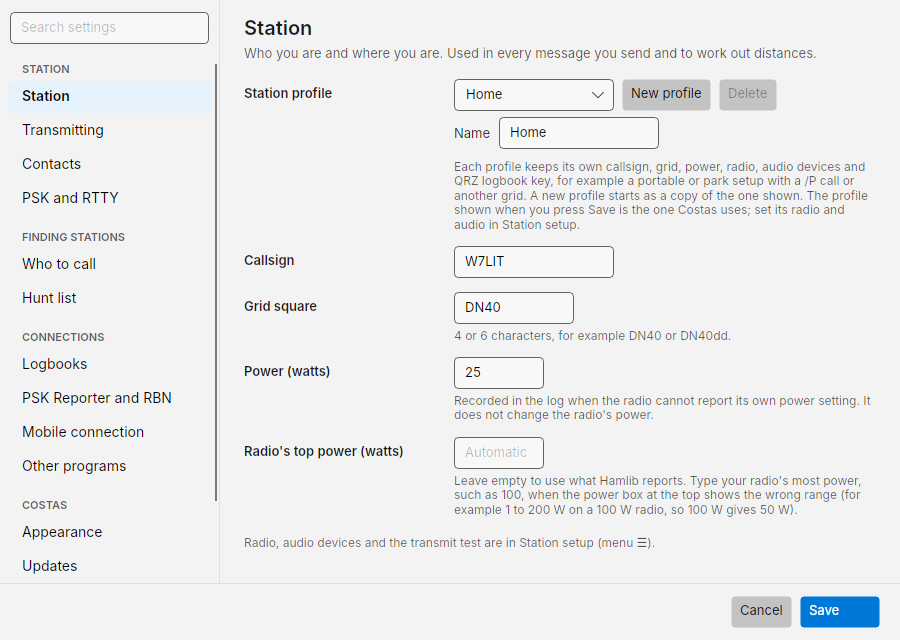

- **Station profile**: which setup you are operating from. Each profile keeps its own callsign, grid, power, radio,
  audio devices and QRZ logbook key, so a portable or park setup with a `/P` call or another grid is one choice away.
  **New profile** adds a copy of the profile shown (same radio and audio) called *Portable*; rename it in **Name**.
  **New operator** adds a profile called *Operator* for another licensed operator using this station: it keeps the
  radio, audio, power, grid, QTH, rig and antenna, and starts with no callsign, name, QRZ key or LoTW, eQSL, Club Log
  or Wavelog account, so they enter their own. Costas asks for the callsign before it saves. Your name, QTH, radio
  and antenna on the PSK and RTTY page also belong to the profile shown.
  **Delete** removes the profile shown (the last one cannot be removed). The profile shown when you press **Save** is
  the one Costas uses from then on; if it uses another radio or sound card, Costas reconnects to it. Changing the
  profile, or the callsign or grid square of the profile in use, changes what you send, so it only happens when the station is idle: while transmitting, during a
  contact, or with CQ or Auto-call on, **Save** and **Apply** refuse and say why, and nothing is saved until you try
  again once the station is idle. Set a profile's radio and audio in **Station setup** while it is the active one. Worked-before and log totals count the contacts
  logged under that profile's callsign.
- **Callsign** and **Grid square** (4 or 6 characters). Used in every message you send and to work out distances.
  A `/P` or `/R` call is sent like any other. A compound call such as `VE3/W7LIT` or `W7LIT/7` does not fit a
  normal FT8 message, so Costas sends it the way WSJT-X does: your CQ is just `CQ VE3/W7LIT` (no grid, and no CQ
  modifier or contest), your answer is `<K1ABC> VE3/W7LIT`, reports go as `K1ABC <VE3/W7LIT> R-10` (your call as
  a short code the other station's program recognises) and the sign-off as `<K1ABC> VE3/W7LIT RR73`. The message
  preview under **Contacts** shows exactly what will go out.
- **US licence class**: Amateur Extra, Advanced, General, Technician, or Not US / don't check. Costas refuses to
  transmit, tune or call CQ anywhere your class may not send data such as FT8, and says where you can. Each profile
  keeps its own, so a club or a second operator's profile can have another class. The check is off until you choose a
  class: a new install starts on **Not US / don't check**, so only the band limits apply. If you used an earlier
  version, your profile keeps what *US data segments only* gave you there (the Amateur Extra segments, unless you had
  turned it off). US operators should pick their class. Licensed in another country? Leave it on **Not US**.

  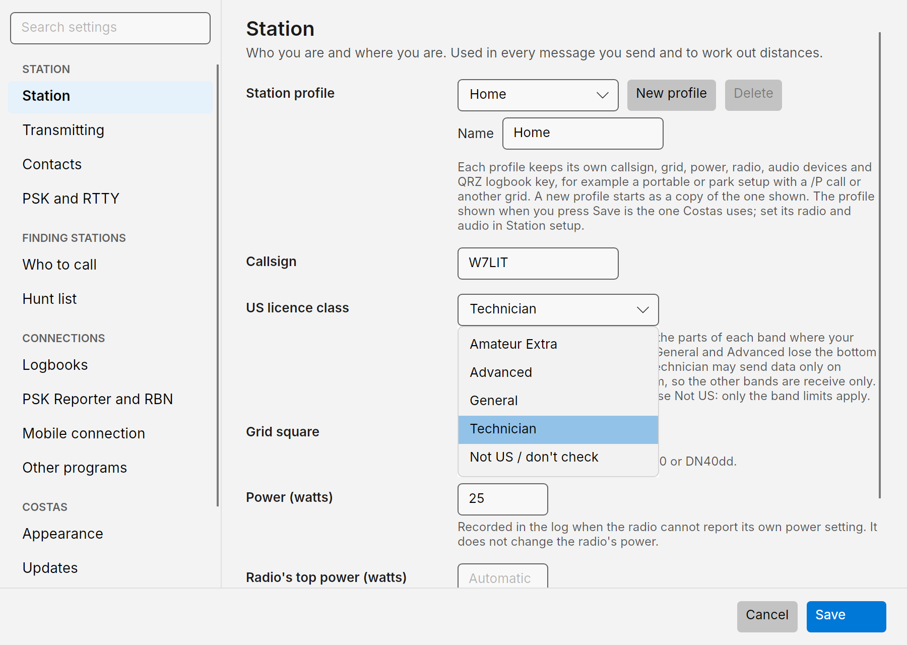

  | Band | Amateur Extra | General and Advanced | Technician |
  | --- | --- | --- | --- |
  | 160 m | 1.800-2.000 | 1.800-2.000 | receive only |
  | 80 m | 3.500-3.600 | 3.525-3.600 | receive only |
  | 60 m | the four channels and 5.3515-5.3665 | same | receive only |
  | 40 m | 7.000-7.125 | 7.025-7.125 | receive only |
  | 30 m | 10.100-10.150 | 10.100-10.150 | receive only |
  | 20 m | 14.000-14.150 | 14.025-14.150 | receive only |
  | 17 m | 18.068-18.110 | 18.068-18.110 | receive only |
  | 15 m | 21.000-21.200 | 21.025-21.200 | receive only |
  | 12 m | 24.890-24.930 | 24.890-24.930 | receive only |
  | 10 m | 28.000-28.300 | 28.000-28.300 | 28.000-28.300 |
  | 6 m | 50.100-54.000 | 50.100-54.000 | 50.100-54.000 |

  All in MHz, from FCC rules 97.301 and 97.305 (checked November 2026). The whole signal has to fit, so FT8 at an
  audio offset of 1,000 Hz on a dial of 14.024 MHz is allowed for a General (it starts on 14.025) and 999 Hz is not.
  Bands that are receive only for your class say so in the band menu; you can still pick them to listen.

  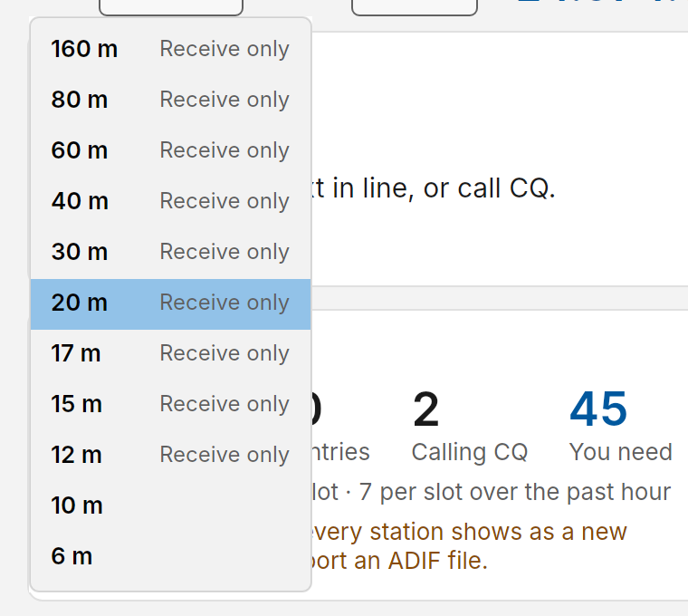

  Since 13 February 2026 the US 60 m segment allows at most 9.15 W ERP (100 W ERP on the channels): set the radio's
  power yourself.
- **Power (watts)**: recorded in the log when the radio cannot report its own power setting. It does not change the
  radio's power.
- **Radio's top power (watts)**: empty (automatic) by default, which uses the range Hamlib reports for your radio. If
  the power box at the top shows the wrong range, for example 1 to 200 W on a 100 W FTDX10 so that asking for 100 W
  gives 50 W, type the radio's real top power here (100). Costas then reads and sets the power as a share of it. Each
  profile keeps its own.
- **FlexRadio amp and tuner**: for a 4O3A **PowerGenius XL** amplifier or **TunerGenius XL** tuner paired with a
  FlexRadio. Type the radio's IP address and press Save; see [FlexRadio amplifier and tuner](#flexradio-amp-and-tuner)
  below. Empty by default. Each profile keeps its own.

### FlexRadio amplifier and tuner {#flexradio-amp-and-tuner}

With a FlexRadio and a PowerGenius XL (PGXL) or TunerGenius XL (TGXL) paired with it, Costas can switch them the way
SmartSDR's amplifier and tuner panels do. Costas talks to the radio, not to the amplifier: the radio passes the
command on, exactly as when you click in SmartSDR.

1. Check that the amplifier and tuner show in SmartSDR and switch from there. If they don't, they aren't paired with the
   radio yet, and Costas won't see them either.
2. Find the radio's IP address: SmartSDR shows it under **Settings › Radio Setup › Network**, and your router's list of
   devices has it too. Giving the radio a fixed (reserved) address in the router saves retyping it later.
3. In Costas, open **Settings › Station**, type the address in **FlexRadio amp and tuner** (for example
   `192.168.1.20`) and press **Save** or **Apply**.
4. The line under the box says what happened, within a few seconds:
    - *Connected. Found PowerGenius XL and TunerGenius XL* means you're done.
    - *Connected to the radio, but it reports no amplifier or tuner*: go back to step 1.
    - *Could not reach the radio at …*: the address is wrong, the radio is off, or the computer and the radio are
      on different networks (a guest Wi-Fi, a VPN).

    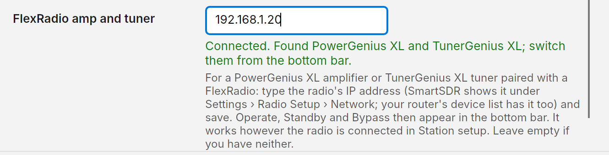

5. The bottom bar now has a button that reads **Amp: Standby  Tuner: Operate ▾** (or whatever they are set to). Click it
   to open the panel:
    - **Operate** and **Standby** for the amplifier.
    - **Operate**, **Standby**, **Bypass** and **In line** for the tuner.

    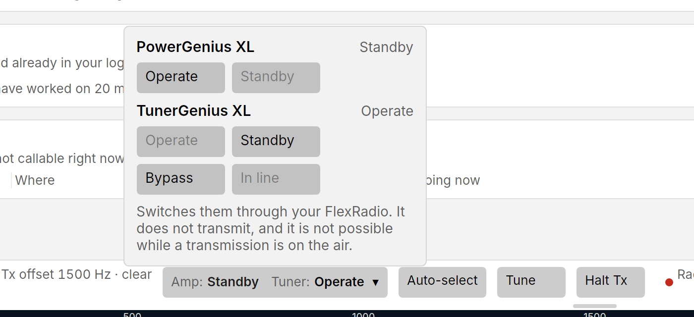

It works however the radio itself is set up in Station setup: **Kenwood › TS-2000** through SmartSDR CAT, **FlexRadio ›
6xxx**, or the **SmartSDR Slice** models. With a SmartSDR Slice model the box can stay empty: Costas uses the address
from Station setup, and the box shows which.

What Costas will and won't do:

- It changes them only when you click. Not when it starts, not on a band change, not when you press Tune.
- The buttons are greyed out while anything is on the air, while the tuner is tuning, and while the amplifier is still
  powering up. A refused click says why under the buttons.
- The bottom bar always shows what the radio reports, not what was clicked. If a click doesn't change the label, the
  radio didn't make the change.
- If the connection drops, the button disappears until it comes back. Transmitting isn't affected: the radio keys the
  amplifier, not Costas.

## Transmitting

The transmit audio level and the safety limits that stop a transmission. Nothing is sent unless you click Call or
Call CQ.

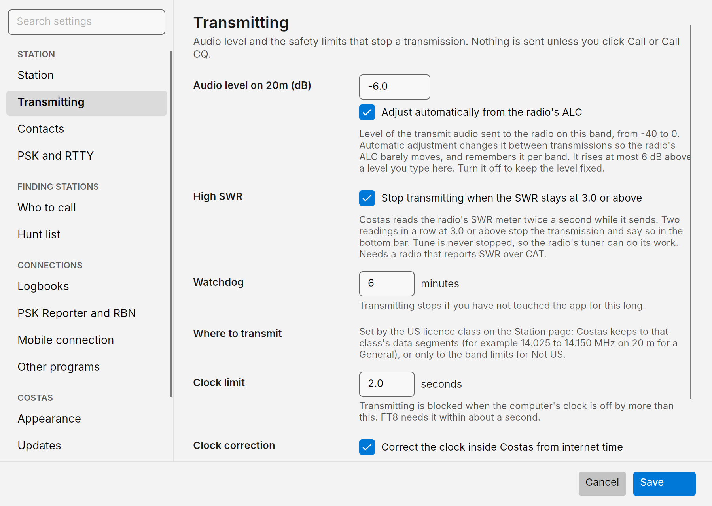

| Setting | Default | What it does |
| --- | --- | --- |
| **Audio level on 20m (dB)** | -6 | Level of the transmit audio sent to the radio on the current band, -40 to 0. Each band remembers its own level |
| **Adjust automatically from the radio's ALC** | on | After each transmission Costas reads the radio's ALC and nudges the level so ALC barely moves: up 0.5 dB when ALC did not move, down when it moved too much. Only the next transmission changes. It never goes more than 6 dB above, or 20 dB below, a level you type here. Turn it off to keep the level fixed. Needs a radio that reports ALC over CAT, such as the FT-710 or IC-7300 |
| **Stop transmitting when the SWR stays at 3.0 or above** | on | While Costas sends, it reads the radio's SWR meter twice a second. Two readings in a row at 3.0 or more stop the transmission (as Halt Tx does) and the bottom bar says why. Tune is never stopped, so the radio's tuner can work. Needs a radio that reports SWR over CAT |
| **Watchdog** | 6 minutes | Transmitting stops if you have not touched the app for this long. A contact the other station is answering is finished first |
| **Where to transmit** | | Set by the **US licence class** on the Station page: Costas keeps to that class's data segments, or only to the band limits for *Not US*. This replaces the *US data segments only* switch of earlier versions |
| **Clock limit** | 2.0 seconds | Transmitting is blocked when the PC clock is off by more than this |
| **Clock correction** | on | When the PC clock is off, Costas times its slots, transmissions and log entries from internet time instead, checked every 15 minutes. The PC clock itself is not changed. Offsets over a minute are not corrected: set the Windows clock and time zone instead |

## Contacts

How contacts are run once you start one: what you send, when Costas gives up, logging and stations calling you.

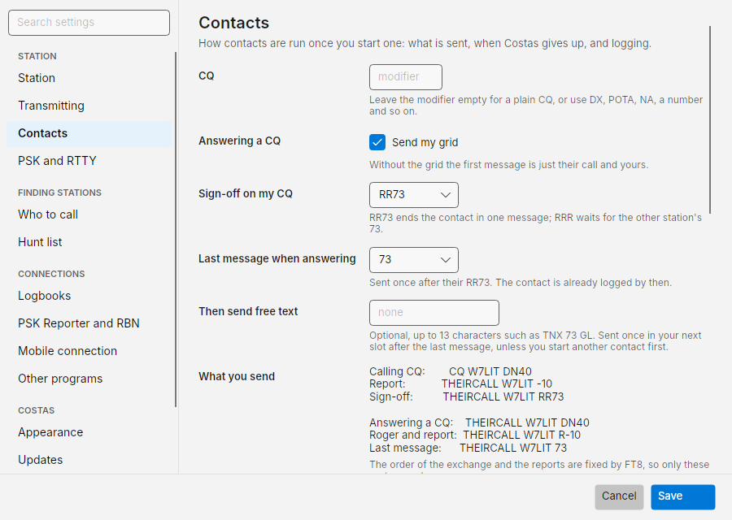

| Setting | Default | What it does |
| --- | --- | --- |
| **CQ** modifier | empty | Empty for a plain `CQ W7LIT DN40`, or `DX`, `POTA`, `NA`, a number and so on: `CQ DX W7LIT DN40`. The dropdown beside **Call CQ** on the Operate screen changes it too |
| **Answering a CQ › Send my grid** | on | Your first message is `THEIRCALL W7LIT DN40`. Off: just `THEIRCALL W7LIT` |
| **Sign-off on my CQ** | RR73 | When you called CQ: **RR73** ends the contact in one message; **RRR** waits for the other station's 73 |
| **Last message when answering** | 73 | When you answered: sent once after their RR73. The contact is already logged by then |
| **Then send free text** | none | Optional, up to 13 characters such as `TNX 73 GL`. Sent once in your next slot after the last message, unless you start another contact first |

**What you send** previews every message exactly as it will go out with your current choices. The order of the
exchange and the reports are fixed by FT8, so only the parts above can change.

| Setting | Default | What it does |
| --- | --- | --- |
| **Call CQ in** | even | Even slots start at :00 and :30, odd slots at :15 and :45 |
| **Give up after** | 4 | Tries without an answer before a contact ends as *No reply* |
| **Late start for a click** | 3 seconds | When you click Call or Call CQ after your slot has started, it still goes out in that slot up to this late, leaving out the part of the message already past. Later, it waits for your next slot. 0 to 5 seconds; FT4 is held to at most 3 seconds, as its message is only 5 seconds long. In FT8 a message up to 3 seconds short still decodes down to about -18 dB. Automatic replies keep a 1 second limit |
| **Double-click** | off | On: in FT8 and FT4, double-clicking another station in Next in line or Repeats during a contact ends the contact (as Abandon does; one already logged stays logged) and calls the new one. Off: during a contact a double-click does nothing. See [Switching to another station](contacts.md#switching-to-another-station) |
| **Logging** | on | Log each contact automatically when it completes |
| **Station is busy** | off | On: keep calling a station that is working someone else, as WSJT-X does. A Call on a station already in a contact calls it anyway, and a station that answers another caller is called again until it answers you, **Give up after** is reached, or you stop. Off: Costas stops and the contact card says *In another contact* |
| **Calling you › Chime** | off | A chime on the computer's default speakers when a new station calls you. Never on the radio's audio device. A desktop notification for a new caller is set in [Notifications](#notifications) |

## PSK and RTTY

| Setting | Default | What it does |
| --- | --- | --- |
| **Your name**, **Your QTH** | empty | Sent by the macros as `{MYNAME}` and `{MYQTH}`. A macro that needs one is not sent while it is empty |
| **Your radio and antenna** | empty | Sent as `{MYRIG}` and `{MYANT}` (the F5 macro) |
| **Macros** | F1 CQ, F2 Answer, F3 Exchange, F4 73, F5 Rig and antenna | The text of each function key. **Add a key** goes up to F12; **Restore the defaults** puts the five back. See [Macros](keyboard-modes.md#macros) |
| **RTTY power** | 50 % | The share of the radio's power used in RTTY. 100 leaves it alone |

How RTTY is read: speed (45.45 baud), shift (170 Hz), **Reverse** (off) and **Unshift on space** (on). PSK31 and PSK63
need no settings. See [RTTY settings](keyboard-modes.md#rtty-settings).

## Who to call

How the Next in line list on the Operate screen is ordered. The same options open from the **ⓘ** beside *Next in
line*.

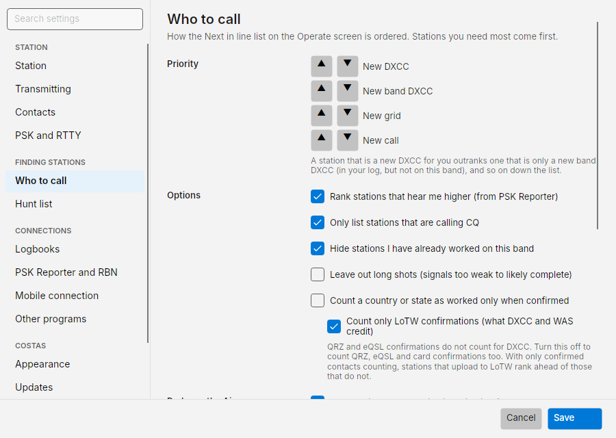

- **Priority**: the order of need tags. By default a new DXCC outranks a new band DXCC (in your log, but not on this band), which outranks a new grid,
  which outranks a new call. Use ▲ ▼ to reorder.
- **Rank stations that hear me higher (from PSK Reporter)**: on.
- **Only list stations that are calling CQ**: on. Off also lists stations finishing a contact.
- **Show Repeats: stations I have already worked on this band**: on. Stations already in your log on this band and
  mode are never in Next in line (except one at a park you have not worked); [Repeats](operate.md#repeats) lists them
  under Next in line so you can work a friend or a regular again. Calling one from Repeats logs another contact. Off
  hides Repeats on the desk and on the phone.
- **Leave out long shots (signals too weak to likely complete)**: off.
- **Count a country or state as worked only when confirmed**: off.
    - **Count only LoTW confirmations (what DXCC and WAS credit)**: on. Off counts QRZ, eQSL and card confirmations too.
      With only confirmed contacts counting, stations that upload to LoTW rank ahead of those that do not.
- **Keep CQ callers listed**: 2 minutes. How long a station calling CQ stays in Next in line after it was last heard.
  Choices run from *Only while heard every slot* (the list drops a station the first slot it is missed) to 15
  minutes. A station heard working someone else leaves the list straight away whatever this says.
- **Worked stations count as new again**: *Never (any contact makes it a repeat)*. A station you have worked on this
  band and mode goes to Repeats. Pick *After 7 days*, *30 days*, *90 days*, *6 months*, *1 year*, *2 years* or
  *5 years* to have it count as a new call again once your last contact with it on this band and mode is that old:
  it moves back into Next in line (and so into Auto-call) tagged *New call*, and its **Last worked** column shows
  when you last worked it. A contact on another band or mode doesn't count either way.
- **Parks on the Air: Show which park a station is activating (POTA spots)**: on. Costas reads the public spot list
  at pota.app every two minutes while it runs and shows *New park* or *Park* with the reference under **Why**
  ([Operate](operate.md#next-in-line)). When you log a contact with a spotted activator, the park goes into the log
  (see [Log](log.md#what-costas-logs)). If pota.app cannot be reached, the **POTA** indicator says so and Costas tries
  again less often; nothing else is affected. Off makes no requests.
  - **Rank stations at a park I have not worked higher**: on. A spotted activator at a park that is not in your log
    comes right after your first need (new DXCC by default) and ahead of everything else, and it is listed in
    **Next in line** even when you have worked that call on this band before. A station calling CQ POTA that nobody
    has spotted is not moved, since Costas cannot tell which park it is at.
- **DXpeditions: Show announced DXpeditions (NG3K)**: on. Costas reads NG3K's list of announced DX operations
  (ng3k.com) at most twice a day and keeps a copy, so starting Costas again does not read it again. A station that is
  one of them shows *DXpedition* and the country under **Why** and in its details, and the
  [Awards](awards.md#dxpeditions-on-the-air) view lists the ones on the air and starting soon. It never changes the
  order or who is called. Off makes no requests.
- **DX cluster: Show DX cluster spots of stations I need**: off. Type the address and port of a DX cluster node
  (port 7300 on most nodes), or pick one from *Or pick a well-known node*. Use your club's node if it has one: the
  well-known nodes are run by volunteers, and Costas does not prefer any of them. Costas logs in with your callsign and
  only reads the spots: it never sends spots, filters or commands. Needed stations spotted in the mode you are in are
  listed on the [Awards](awards.md#spotted-on-the-dx-cluster) view, and a station you are hearing shows *Spotted 4 min
  ago* under **Why** ([Operate](operate.md#next-in-line)). Spots never change the order, who is called or the radio's
  frequency. While it is on, a **DX cluster** indicator in the bottom bar says whether Costas is connected; if the node
  cannot be reached Costas tries again less often, and nothing else is affected. Nodes that ask for a password are not
  supported. Which spots a node sends (FT8 skimmer spots in particular) depends on your settings stored on that node.

  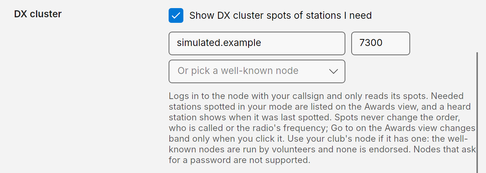

## Hunt list

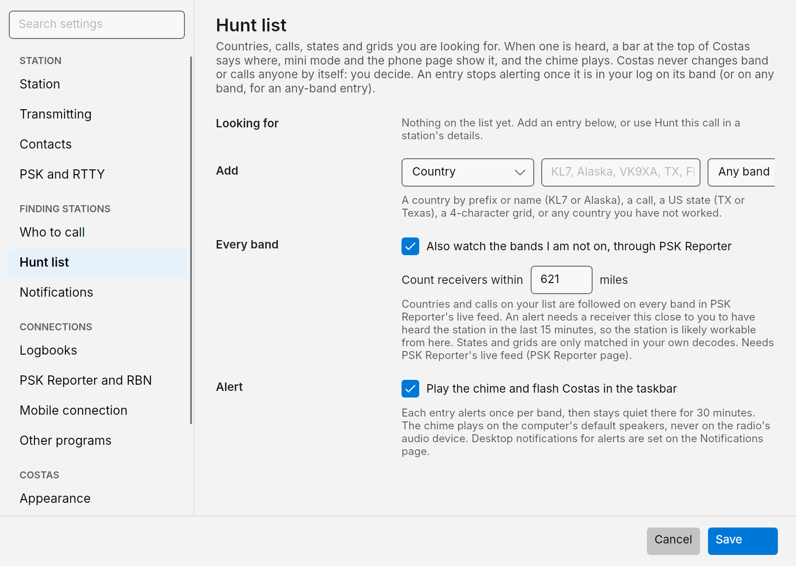

What you are looking for, and how you are told. See [Hunt list and alerts](hunt.md).

- **Looking for**: the entries, each with **Remove**.
- **Add**: the kind (Country, Call, US state, Grid, Any new country), what to look for, and a band or *Any band*.
- **Also watch the bands I am not on, through PSK Reporter**: on. **Count receivers within** 620 miles (1,000 km).
- **Play the chime and flash Costas in the taskbar**: on.

## Blocked calls

Calls you do not want to work. See [Blocking a call](contacts.md#blocking-a-call).

- **Blocked**: the entries (*ON4XYZ on 20 m*, *ON4XYZ on every band in FT8*), each with **Remove**.
- **Add**: the call, a band or *Every band*, and a mode or *Every mode*.

## Notifications

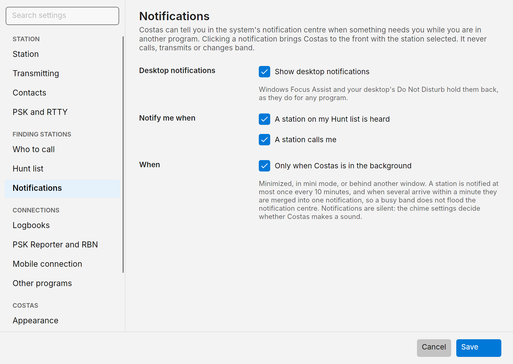

Desktop notifications, in Windows' notification centre or your Linux desktop's. Clicking one brings Costas to the
front with the station selected; it never calls, transmits or changes band. There are no buttons on them.

- **Show desktop notifications**: on.
- **Notify me when**: *A station on my Hunt list is heard* (on) and *A station calls me* (on). A caller's
  notification reads *W1ABC is calling you · 20 m FT8 · -9 dB · W7LIT W1ABC FN31*.
- **Only when Costas is in the background**: on. Background means minimized, in mini mode, or another program in
  front. Off: notifications show even while you are looking at Costas.

A station is notified at most once every 10 minutes, and several within a minute share one notification
(*3 stations are calling you*), so a busy band does not flood the notification centre. Notifications are silent:
the chime settings decide whether Costas makes a sound. Windows Focus Assist and your desktop's Do Not Disturb hold
them back as they do for any program. If this computer has no notification centre Costas can use, the page says so
and nothing is shown.

## Logbooks

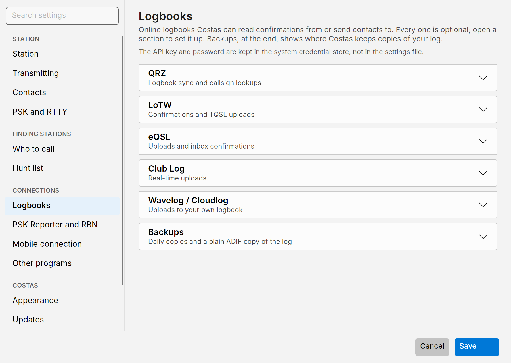{ width="900" }

QRZ, LoTW, eQSL, Club Log and Wavelog / Cloudlog are sections of one page; click a section's name to open it. All
are optional, and passwords and keys are kept in Windows Credential Manager. The last section, Backups, shows where
Costas keeps copies of your log.

### QRZ

QRZ has two services, each with its own sign-in. Both are optional.

- **Logbook API key**: opens your logbook only, for what you have worked and confirmed and for uploading contacts.
  Find it in your QRZ Logbook's Settings. **Test key** checks it. **Open the QRZ Logbook** goes to qrz.com.
- **Sync**: **Read my logbook and upload new contacts**, **Upload each contact as soon as it is logged**, and
  **Check for changes every** 15 minutes.
- **Callsign lookups**: your QRZ username and password, for the name, city and state of other stations. **Test
  login** checks them. Leave both blank to turn lookups off.

The key and password are kept in Windows Credential Manager.

### LoTW

Logbook of the World confirmations, uploads through TQSL, and the list of LoTW users. See [LoTW](log.md#lotw). The
login, Station Location and automatic upload belong to the current station profile, so each operator uses their own
account; where TQSL is and the list of LoTW users are shared by all profiles.

- **Confirmations**: **Download my LoTW confirmations**, your LoTW login (usually your call) and LoTW website
  password. This is the website password, not the TQSL certificate password.
- **Uploads (TQSL)**: where `tqsl.exe` is (leave blank to find it in its usual folder), the TQSL **Station Location**
  to sign with (blank if TQSL has only one), and **Sign and upload each contact as soon as it is logged** (off).
- **Who uses LoTW**: **Download ARRL's list of LoTW users once a week** (on, about 6 MB, no login).

The password is kept in Windows Credential Manager, one for each station profile.

### eQSL

In **Settings › Logbooks › eQSL**, enter your eQSL.cc username and password, and copy the **QTH nickname** for the
current callsign and location from your eQSL account. Credentials stay in the system credential store when
available. Each station profile has its own account settings.

Enable **Upload each new contact** for automatic uploads. Contacts queue locally and retry after failures,
even after restarting Costas. The Log view shows eQSL delivery independently of QRZ.

Enable **Read my eQSL inbox** to fetch incoming cards hourly. **Sync inbox now / test login** reads the inbox
with the values entered on this page, even before saving them. A sync stores incoming cards and confirms a
local contact when its callsign, band and mode match one contact within 15 minutes (the other station logs its own
start time, often a minute or two from yours). With several contacts in that time, only one in the same minute is confirmed. Unmatched cards remain visible in
the recent inbox list; they do not create contacts automatically. FT4 and MFSK/FT4 match as the same mode.

Both automatic features are off by default. Save to apply. Simulation never contacts eQSL.

### Wavelog / Cloudlog

If you keep your log in your own [Wavelog](https://www.wavelog.org) or Cloudlog site, Costas can send each contact
there as soon as it is logged. In **Settings › Logbooks › Wavelog / Cloudlog**:

1. Enter the **Logbook address**, the address you open your logbook at (such as `https://log.example.com`). Use
   https: the API key goes with every upload.
2. In your logbook, make an API key with read and write access (under your account's API keys) and paste it into
   **API key**. It stays in the system credential store, not in the settings file.
   On Wavelog 3.1 or later you can paste a v2 API token instead (it starts `wl2_`). Costas sees the `wl2_` and
   uses Wavelog's v2 API for it; any other key uses the original API, which Cloudlog and every Wavelog version
   have. The line under the key says which one. Give a v2 token the **qso:write** scope so it can upload, and
   **station:read** so Test can list your station locations.
3. Press **Test and list station locations**. Costas asks the logbook which station locations the key can use and
   picks the one whose callsign matches this profile. Choose another from the list, or type its id, if needed. The
   logbook only takes contacts for a location with this profile's callsign. With a v2 token, Test first says what
   the token may do (read contacts, upload them, or both, and until when it works), and warns if uploads are on
   but the token cannot upload. A token without station:read cannot list locations: type the station's number
   from Wavelog's Station Locations page.
4. Tick **Upload each new contact as soon as it is logged** and save.

Contacts queue locally and retry when the site is down, even after restarting Costas. A contact already in that
logbook is left alone and counts as sent. A wrong key or station id waits an hour before the next try; the
**Wavelog/Cloudlog** indicator in the bottom bar (shown once this is set up) says what the logbook answered. Each
station profile has its own settings. Off by default. Simulation never contacts the site.

#### Using Wavelog as your logbook for worked-before

With a Wavelog v2 token you can also tick **Download my Wavelog log for worked-before**. Costas then brings that
station location's Wavelog contacts into its own log, so a caller you have worked shows as Worked, and a new country,
band or grid shows as new, just as with the QRZ logbook. The first download reads the whole log. After that Costas
asks only for contacts added since, every 15 minutes, and at once when you change the profile or its Wavelog
settings.

- The token needs the **qso:read** scope. A read-only token is enough, and it is the safest choice for another
  operator: Costas cannot change their Wavelog log with it. Upload and download are separate switches, so you can
  use either or both. A v1 key cannot download: the box stays unavailable until you enter a `wl2_` token.
- Downloaded contacts show "From Wavelog" in the Log tab and are never sent back to Wavelog. If a contact you logged
  in Costas is still waiting to upload when the download finds it already in Wavelog, Costas does not send it again.
- A contact you delete in Costas stays deleted; the next download does not bring it back. A contact you edited keeps
  your edits.
- The **Wavelog/Cloudlog** indicator shows the download's result, such as "Downloaded 1,204 contacts from
  log.example.com" or "log.example.com log up to date". A refused token waits an hour before the next try.

### Club Log {#club-log}

Costas can send each contact to [Club Log](https://clublog.org) as soon as it is logged, so a DXpedition's online
log shows it at once. In **Settings › Logbooks › Club Log**:

1. Enter the **Account email** you sign in to Club Log with (not your callsign).
2. In Club Log, open Settings › API and make an **Application Password**. It is shown once: paste it into
   **Application Password**. It stays in the system credential store, not in the settings file.
3. Tick **Upload each new contact as soon as it is logged** and save.

The profile's callsign must be one of the callsigns on that Club Log account. Contacts queue locally and retry when
Club Log is down. A contact Club Log already has counts as sent; one it rejects (a bad date, say) is dropped from the
queue and the **Club Log** indicator says why. If Club Log refuses the login, uploads stop until you change the email
or password, because Club Log blocks programs that keep trying. Each station profile has its own settings. Off by
default. Simulation never contacts Club Log.
### Backups {#backups}

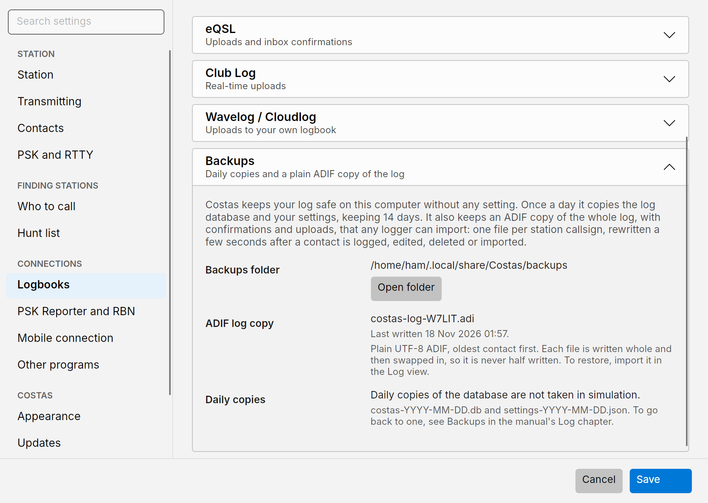{ width="900" }

Nothing to set: Costas keeps copies of your log on its own. This section shows:

- **Backups folder**: where the copies are, with an **Open folder** button.
- **ADIF log copy**: the file names (one per station callsign) and when they were last written. If a write failed it
  says why and when Costas tries again. See [ADIF copy of the log](log.md#adif-copy).
- **Daily copies**: the newest daily copy of the database. In simulation none are taken, as the picture above shows.

## PSK Reporter

The page is called **PSK Reporter and RBN** in Settings.

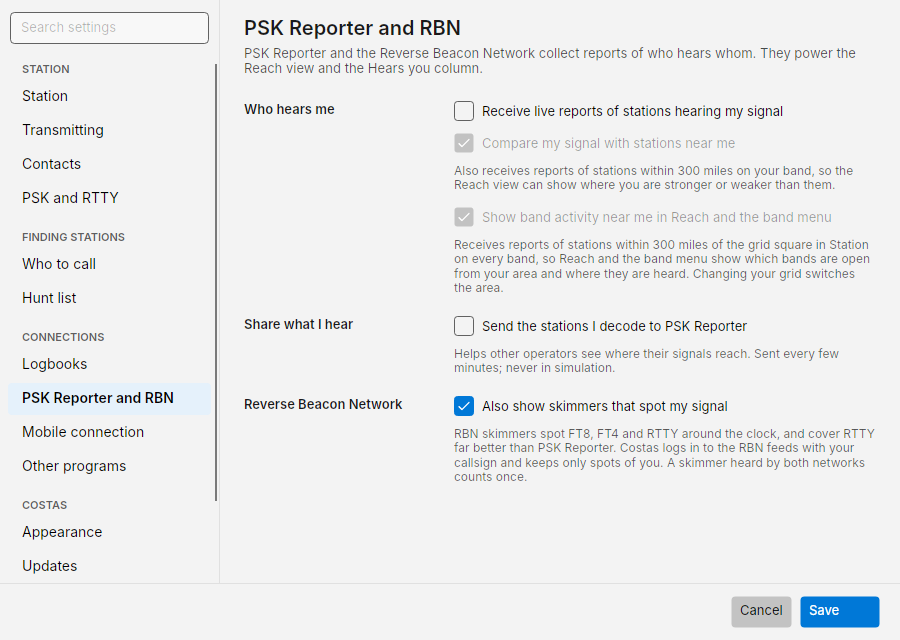

- **Who hears me › Receive live reports of stations hearing my signal**: on. Powers the Reach view and
  Chance.
- **Who hears me › Compare my signal with stations near me**: on. Also receives reports of other stations within
  300 miles on your band, for *Compared with stations near you* in the Reach view. Nothing about them is saved.
- **Who hears me › Show band activity near me in Reach and the band menu**: on. Receives reports of stations within 300 miles on
  every band, using the current grid square in **Station**, so Reach and the band menu show which bands are open from your area. Changing the grid switches the area. Nothing about these reports is saved.
- **Share what I hear › Send the stations I decode to PSK Reporter**: off. Helps other operators see where their
  signals reach. Sent every few minutes, never in simulation.
- **Reverse Beacon Network › Also show skimmers that spot my signal**: on. Costas logs in to the
  [Reverse Beacon Network](https://reversebeacon.net/) feeds with your callsign and keeps only spots of you, in FT8,
  FT4 and RTTY (RBN covers RTTY much better than PSK Reporter). They join PSK Reporter's reports in Reach, the globe,
  the countries line and Chance. A skimmer heard by both networks counts once. Nothing you decode is sent to RBN.

## Other programs

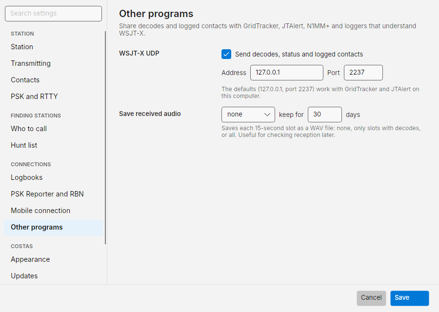

- **WSJT-X UDP › Send decodes, status and logged contacts**: on, to `127.0.0.1` port `2237`. Works with GridTracker,
  JTAlert and DXLab SpotCollector on the same computer.
- **Also send to a second program**: off, `127.0.0.1` port `2238`. Two programs cannot listen on one port, so to run
  DXLab SpotCollector alongside JTAlert or GridTracker, set one of them to `2237` and the other to `2238`, here and in
  each program. Both get the same decodes, status and logged contacts, and either can call a station or halt transmit.
- **ALL.TXT › Write every decode and transmission to ALL.TXT, one folder per month**: off. When on, Costas also writes
  each decode and transmission in WSJT-X's `ALL.TXT` line layout to a folder for each month, such as
  `Documents\Costas\2026-11\ALL.TXT`, for programs and scripts that read it. **Folder** changes where the month
  folders go; **Open folder** shows it. Not written in simulation.
- **Save received audio**: none, only slots with decodes, or all, as WAV files, kept for 30 days by default.

### DXLab Suite {#dxlab}

Costas speaks to the DXLab Suite the way WSJT-X does, so DXLab's own WSJT-X settings apply.

- **Radio**: choose **DXLab › Commander** in [Station setup](setup.md#2-radio-cat-and-ptt). Commander keeps the
  radio, and Costas sets frequency, mode and split and keys through it.
- **SpotCollector**: point it at the WSJT-X UDP port above (2237, or the second program's port when JTAlert or
  GridTracker has 2237). Every decode goes to SpotCollector as a spot. Double-clicking a spot in SpotCollector
  selects that station in Next in line; Costas does not call it until you click **Call**. When SpotCollector starts
  after Costas, it asks for the decodes it missed and Costas sends the last 15 minutes again.
- **DXKeeper**: each logged contact goes to SpotCollector as a full ADIF record, and SpotCollector passes it to
  DXKeeper, so DXKeeper's duplicate and award checks see it at once. SpotCollector's WSJT-X *Enable* box must be
  ticked and DXKeeper running. A contact logged while either was closed can be sent again from the Log: select it and
  press **Send to loggers again**. For a batch of older contacts, export them with a date range and import the file
  into DXKeeper (see [Exporting for DXKeeper](log.md#export-dxkeeper)).
- **DXView and Pathfinder**: the station you are working is sent in Costas's status, so SpotCollector can look it up
  in DXView and Pathfinder as it does for WSJT-X.
- **Highlights**: when a program sends WSJT-X's *Highlight Callsign* message for a needed station, the colours show on
  the [Raw decodes](raw-decodes.md) page.

## MQTT

Publishes station events (the on-air session, transmitting, band, frequency, mode and logged contacts) to an MQTT
broker for Home Assistant, Node-RED or your own scripts. One way only: nothing on the broker can change Costas. See
[MQTT publishing](mqtt.md) for the topics and a Home Assistant example.

## Mobile connection

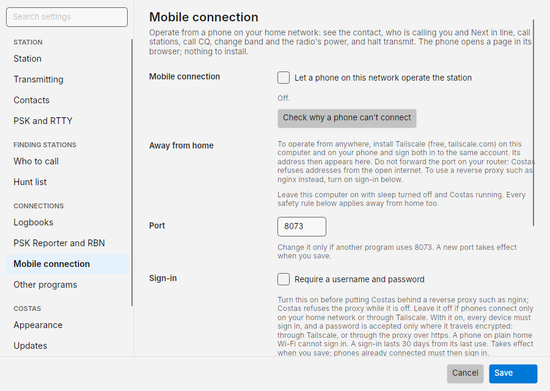

- **Let a phone on this network operate the station**: off by default. Takes effect at once and shows the address
  to open on the phone. There is no code: any phone on your home network can connect.
- **Port**: `8073`, applied when you save.
- **Require a username and password** (under **Sign-in**): off by default. With it on, every device signs in with a
  user from the list below, a password is accepted only through Tailscale or a reverse proxy over https (not on plain
  home Wi-Fi), and Costas allows a reverse proxy such as nginx. Takes effect when you save.
- **Proxy address**: leave empty when the proxy runs on this computer; otherwise the address of the computer that runs
  it.
- **Add a user**, **Edit**, **Allowed to sign in**, **Operates as**, **Sign out everywhere**, **Delete**: who may sign
  in, and the station profile each operates as. See
  [Requiring a username and password](phone.md#requiring-a-username-and-password).

See [Operating from a phone](phone.md).

## Appearance

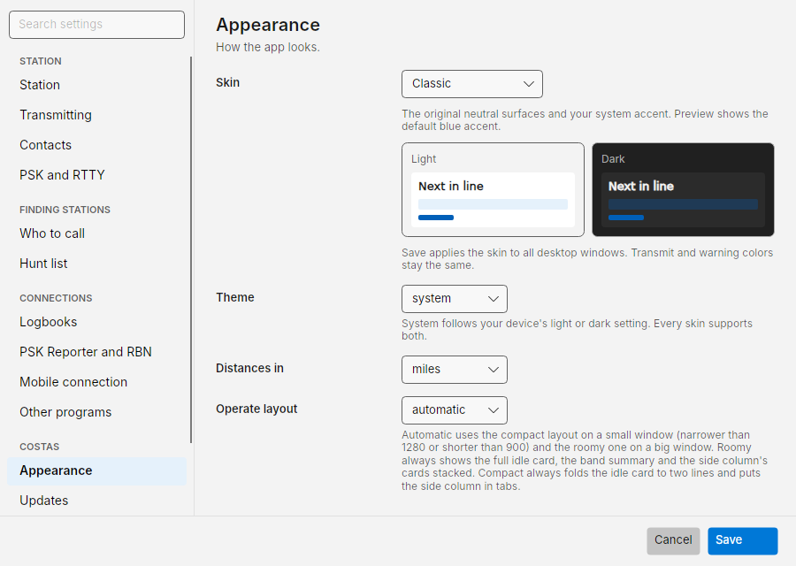

- **Skin**: Classic (the original appearance and system accent), Ocean (cool blues), Forest (soft greens), or
  Amber (warm sand and copper). Four instrument skins also change the faceplate, typography, panel shapes and controls:
  **Modern Radio** has a recessed digital display and a dial button; **Classic Transceiver** has a gray and black
  faceplate, lime green seven-segment LCD digits and a black tuning dial; **Vintage Receiver** has warm dial lighting,
  brass trim, rounded controls and a sweeping slot needle; **SDR Console** has square modules, monospace readouts
  and a segmented slot strip. Their meters show progress through the current FT8 or FT4 slot; with one of these skins the faceplate is the
  only slot countdown, so the contact card and bottom bar leave theirs out. The display also carries the radio's
  power out, ALC and SWR meters (in place of the bottom bar's) once the radio has reported them. Click the large
  frequency display or **DIAL** button to open the same frequency editor used by Classic.
  Light and dark swatches preview your choice. Press **Save** to apply it to all desktop windows; it is remembered
  the next time you start Costas. Transmit and warning colors stay the same.
- **Theme**: system (follows your device's light or dark setting), light or dark. Each skin supports both.
- **Distances in**: miles or kilometres.
- **Operate layout**: **automatic** (the default) uses the compact layout on a small window, narrower than 1280 or
  shorter than 900, and the roomy layout on a big one; **roomy** or **compact** keeps that layout at any size. See
  [Big and small windows](operate.md#big-and-small-windows).

## Updates

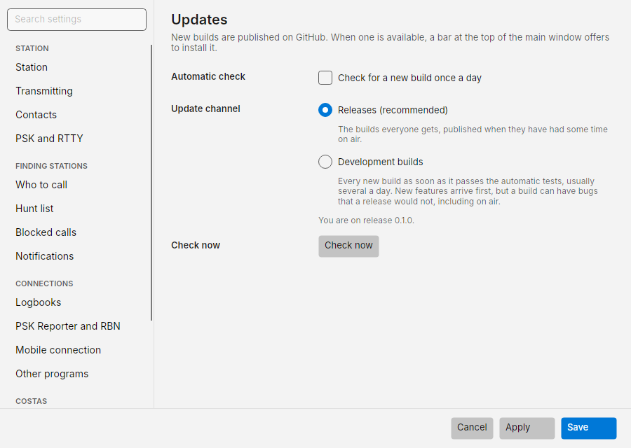

**Check for a new build once a day** (on) and **Check now**. See [Install › Updates](install.md#updates).

**Update channel** (Releases) chooses which builds the update bar offers: **Releases**, the builds everyone gets, or
**Development builds**, every new build as soon as it passes the automatic tests. The line under the choice says which
kind you are running now. After you save, Costas checks straight away. Switching back to Releases offers the latest
release even though it is older than your development build; your log and settings are kept. See
[Install › Development builds](install.md#development-builds).

## Privacy

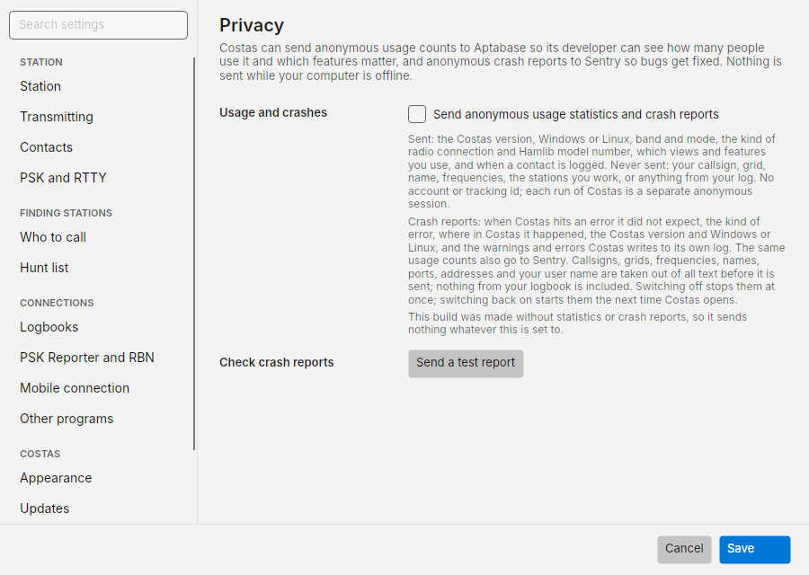

**Send anonymous usage statistics and crash reports** (on). Costas sends a few anonymous counts to
[Aptabase](https://aptabase.com), an open-source analytics service built for privacy, so its developer can see how many
people use it and which features matter, and an anonymous report to [Sentry](https://sentry.io) when it hits an error it
did not expect, so the bug can be found and fixed. Untick the box to stop sending both.

What is sent:

- the Costas version and whether it is running on Windows or Linux;
- the band and mode you are on, and whether your radio is connected through Hamlib, VOX or not at all, with the Hamlib
  model number (the same number for every owner of that radio);
- which optional features are switched on (QRZ logbook, LoTW, eQSL, PSK Reporter, POTA spots, other programs, the
  phone remote), your Operate layout, how many station profiles you have and how many entries your Hunt list has;
- how Costas was installed (installer, .deb, AppImage or an unpacked folder) and whether it is a release or a
  development build;
- which views and windows you open, and when you call CQ, call or answer a station, use Tune, a macro key (its number
  only), auto-call, contest mode or a Hunt list alert, and log a contact (band and mode only);
- how Station setup goes: which steps you reach or skip, whether the radio test found the radio (or why not, such as no
  ports or a port in use) and whether the test tone was sent;
- whether the radio connected when Costas opened it, or the kind of reason it did not;
- when a transmission is refused, the kind of reason (clock off, outside the band, audio output muted, radio fault),
  and when the SWR stop ends one;
- whether an update installed or failed, and when an online service (QRZ, LoTW, eQSL, Club Log, Wavelog/Cloudlog, PSK
  Reporter and the spot feeds) stops or starts working;
- once an hour of decoding, how many slots were decoded, how many decodes they had on average and how long a decode
  took (rounded to a tenth of a second);
- when the phone remote connects, whether it is a phone, tablet or computer and whether it came over your home network
  or Tailscale, and which of its buttons are used;
- when you close Costas, roughly how long it was open (such as "1-2h") and how many contacts it logged (up to 100);
- roughly how long ago Costas was first used with statistics on (such as "8-30 days"), on how many of the last 30
  days it was used, and the first time each feature is used on this computer.

What is never sent: your callsign, grid, name, frequencies, serial ports or network addresses, the stations you hear or
work, or anything from your log. There is no account and no tracking id; each run of Costas is a separate anonymous
session.

To work out the install age, the active days and "first time a feature is used", Costas keeps a small file,
`usage-history.json`, next to your log. It holds only dates (the first day and the days Costas ran in the last 60)
and the names of the features used; it is never sent as it is, and it is only updated while statistics are on.

Nothing is sent while your computer is offline. Counts wait in memory and go out when the network is
back; anything still waiting when you close Costas is dropped. Statistics are never sent in simulation, and builds you
make yourself from the source send nothing at all.

### Crash reports, warnings and usage counts in Sentry

When something goes wrong that Costas did not expect (it closes, or shows "Unexpected error" on the status line), it
sends a crash report to Sentry. A report holds:

- the kind of error and where in Costas it happened (the chain of function names in Costas's code);
- the error's text, with callsigns, grids, frequencies, names, serial ports, network and email addresses, web
  addresses' details and your Windows or Linux user name taken out first;
- the Costas version, Windows or Linux and its version, and the .NET version Costas runs on.

Costas also sends Sentry the **warnings and errors** it writes to its own log (for example "the radio did not
answer" or "QRZ could not be reached"), scrubbed the same way, and the **same usage counts** that go to Aptabase.
Information lines from the log, such as decodes and logged contacts, are never sent. An error in the log, or a
warning caused by an error inside Costas, also goes in as a crash report (at most once per kind of error each time
Costas runs, and at most 25 in a run), so problems Costas recovers from still get seen and fixed.

Nothing sent to Sentry holds your callsign, grid, name, frequencies, the stations you hear or work, anything from your
logbook, your computer's name or your network address. There is no account and no tracking id: each run of Costas gets
a new random id, so one run's lines can be read together and nothing more.

Nothing is sent while your computer is offline: a report waits in the `crash-reports` folder next to your log (at most
30 of them) and goes out when the network is back. Unticking the box stops reports at once, and anything still waiting
is deleted the next time Costas starts. Ticking it again starts reports the next time Costas opens. Reports are never
sent in simulation, and builds you make yourself from the source send nothing at all.

**Send a test report** (Settings › Privacy) sends a made-up error, named `CrashReportTestException`, so you can
see that crash reports get through. It follows the box above: with the box unticked, or in a build without crash
reports, nothing is sent and the button says why. If you have just ticked the box, save and restart Costas first.

Problem reports are separate: they are only sent when you press **Send** in **☰ › Report a problem…**, and contain
only what you see there. See [Report a problem](troubleshooting.md#report-a-problem-or-send-feedback).

## Advanced

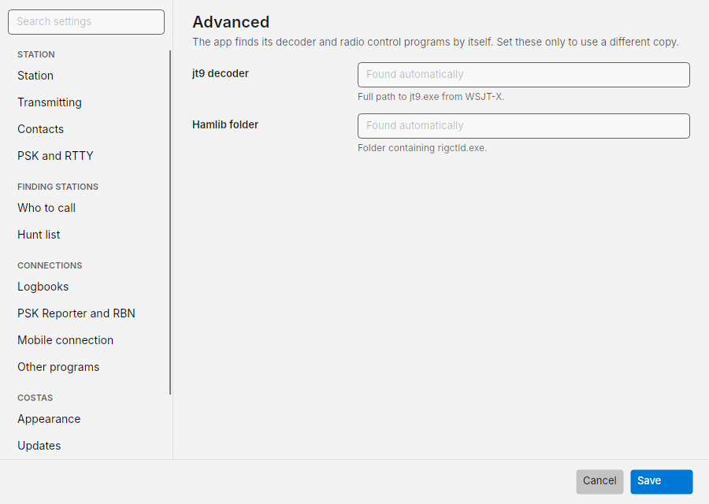

Costas finds its decoder and radio control programs by itself, and brings its own `jt9`. Set **jt9 decoder** (full
path to `jt9`, `jt9.exe` on Windows, or a WSJT-X folder) or
**Hamlib folder** (the folder containing `rigctld.exe`, or the Hamlib folder with it in `bin`) only to use a different copy, for example a newer Hamlib
for a radio the bundled one does not support.

A WSJT-X **AppImage** cannot be used as the jt9 decoder, because running it opens WSJT-X itself. Leave the setting
empty to use Costas's own `jt9`. To use the AppImage's copy instead, run it once with `--appimage-extract` in its own
folder and set the path to the AppImage or to `squashfs-root/usr/bin/jt9` beside it.

## Developer mode

Hidden by default. In **☰ › About**, click the product name seven times. Settings then has a **Developer** section
(replay the sample recordings instead of the sound card, optionally with a simulated station that answers your
calls; replay always uses a simulated radio, so your own radio is never keyed), and Station setup lists Hamlib's test radio, *Hamlib Dummy*, which never plays transmit audio. This is for
testing Costas, not for operating.

Development builds used to be switched on here. The choice is now **Update channel** in [Updates](#updates), and
developer mode is not needed for it.
